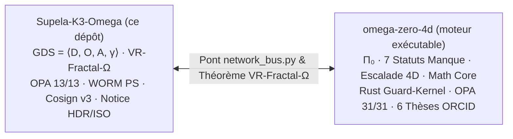

# SUPELA MONOLITHE — Exécution & Preuve (`Supela-K3-Omega`)

[](https://github.com/gadboisjean1000-arch/Supela-K3-Omega/actions/workflows/opa-gds-ci.yml)
[](https://github.com/gadboisjean1000-arch/Supela-K3-Omega/actions/workflows/ci.yml)
[](LICENSE)
[](https://orcid.org/0009-0001-5361-6795)
[](policies/gds_invariants.rego)

> **Executive Summary (EN) :** *Supela-K3-Omega* is the formal monolith and executable policy-proof companion of [Supela Ω-ZERO · Local–Cloud–4D](https://github.com/gadboisjean1000-arch/omega-zero-4d). It encodes the Coherence Operator `γ*` over `GDS = ⟨D, O, A, γ⟩` in OPA Rego v1 (13 refutation tests), idempotent logical WORM storage (PowerShell + Pester), SHA-256-verified Cosign v3 CI pipelines, and the multiscale fractal convergence law [`VR-Fractal-Omega.md`](VR-Fractal-Omega.md). Authored by Jean-François Gadbois ([ORCID 0009-0001-5361-6795](https://orcid.org/0009-0001-5361-6795)).
>
> Nomenclature canonique : `GDS = ⟨D, O, A, γ⟩` · `γ* = γ ∘ Λ` · `SCT = γ*(D,O,A)`
> Principe : ce dossier **ne proclame pas** sa validité ; il la **mesure**.

## Architecture Unifiée de l'Écosystème Supela



## Repères Institutionnels & Scientifiques

- [`NOTICE-HDR-ISO-Monolithe-Probant.md`](NOTICE-HDR-ISO-Monolithe-Probant.md) — Notice d'audit HDR/ISO (`cohérent, partiellement prouvé, non scellé`)
- [`INSTITUTIONAL_STANDARDS.md`](INSTITUTIONAL_STANDARDS.md) — Alignement Défense / Gouvernement / ISO / NIST SSDF / Université
- [`VR-Fractal-Omega.md`](VR-Fractal-Omega.md) — Résolution d'échelle fractale & théorème de moyenne harmonique pondérée (§6)
- [`CITATION.cff`](CITATION.cff), [`SECURITY.md`](SECURITY.md), [`LICENSE`](LICENSE) (`Apache-2.0`) & [`NOTICE`](NOTICE)
- Dépôt compagnon : [`gadboisjean1000-arch/omega-zero-4d`](https://github.com/gadboisjean1000-arch/omega-zero-4d)

## État des verrous (honnête, au 2026-10-09)

| Verrou | Outil | Statut sur cette machine |
|---|---|---|
| **1. Logique** (OPA + idempotence) | opa, Pester | ✅ **Prouvé** — opa 1.21.1 (fmt+check+test) **13/13 PASS** + Pester 7/7 |
| **2. Signature** (non-répudiation) | cosign | ✅ **Prouvé** — `Verified OK` (cosign v3.1.2, format `--bundle`) |
| **3. Silicium** (ancrage matériel) | tpm2-tools | ⏳ **Déclaratif** ici (tpm2_quote absent) — à raccorder |
| 4. WORM logique | PowerShell | ✅ **Prouvé** — `IsReadOnly` + ledger append-only |

## Prérequis

- `opa` — https://openpolicyagent.org (verrou 1)
- `cosign` — Sigstore (verrou 2). ⚠️ v3 utilise `--bundle` (pas `--output-signature`).
- `tpm2-tools` — `tpm2_quote`/`tpm2_checkquote` (verrou 3, machine avec TPM).
- PowerShell + module **Pester** (verrou 1).

## Exécution (orchestrateur Windows/local)

```powershell
.\monolithe.ps1 -Task Test     # opa fmt/check/test + Pester (idempotence)
.\monolithe.ps1 -Task Sign     # cosign sign-blob --bundle (manifeste + ledger)
.\monolithe.ps1 -Task Verify   # cosign verify-blob --bundle  → doit afficher "Verified OK"
.\monolithe.ps1 -Task Attest   # tpm2_quote (si TPM présent)
.\monolithe.ps1 -Task Clean    # supprime les preuves temporaires
.\monolithe.ps1 -Task All      # enchaîne Test→Sign→Attest→Verify
```

Pour `Sign`/`Verify`, place `cosign.key`/`cosign.pub` dans le répertoire courant (ou adapte `-Task`). Génération : `cosign generate-key-pair` (définis `$env:COSIGN_PASSWORD`).

### Équivalent POSIX / CI Linux (Makefile)

```sh
make test    # opa fmt/check/test + Pester (via pwsh)
make sign    # cosign sign-blob --bundle (manifeste + ledger)
make attest  # tpm2_quote — exige un TPM ; échoue honnêtement sinon
make verify  # cosign verify-blob --bundle → "Verified OK"
make clean   # supprime les preuves temporaires
```

> Le `Makefile` (POSIX sh, recettes en TAB vérifiés, nomenclature `GDS = ⟨D, O, A, γ⟩`) complète `monolithe.ps1` : l'un cible la CI Linux, l'autre le poste Windows. Les cibles `sign`/`verify` emploient le format cosign v3 `--bundle`.

## Les 13 tests OPA (suite de réfutation — `tests/gds_invariants_test.rego`)

Chaque test doit **réfuter** une propriété. 2 positifs + 11 négatifs :

**Positifs :** `test_coherence_valid`, `test_allow_valid_on_main`.

**Négatifs (chacun doit faire échouer `coherence_satisfied`/`allow`) :**
1. `test_deny_direct_commit` — commit direct sur `main` interdit.
2. `test_deny_wrong_branch` — mauvaise branche.
3. `test_deny_tampered_ledger` — registre WORM altéré.
4. `test_deny_stale_attestation` — attestation périmée (> 15 min).
5. `test_deny_future_attestation` — horodatage dans le futur (anti-rejeu).
6. `test_deny_hash_mismatch` — l'attestation ne couvre pas le bon artefact.
7. `test_deny_incomplete_attestation` — champ de preuve manquant (ex. `nonce`).
8. `test_deny_quorum_too_few_votes` — moins de 3 votes valides.
9. `test_deny_quorum_ratio_below_threshold` — ratio 3/6 = 0,50 < 0,66.
10. `test_revoked_voter_does_not_count` — le vote d'un agent révoqué ne compte pas.
11. `test_deny_cross_tenant` — tentative d'accès inter-tenant (Zero-Trust).

Exécution : `opa test policies/ tests/ -v --explain=fails`.

## Notes d'honnêteté

- Le CI (`ci/opa-gds-ci.yml`) utilise une **clé cosign jetable** pour prouver le **mécanisme** de signature, pas une identité de production (qui exigerait Fulcio/OIDC keyless).
- La politique OPA vérifie la **présence, la fraîcheur et la cohérence** des preuves, **pas** leur validité cryptographique (rôle de cosign) ni l'ancrage TPM (rôle de tpm2-tools).
- **Scellement interdit** tant que les verrous 1 (CI) et 3 (TPM) ne sont pas exécutés dans le pipeline.

> **Principe Graal :** on sait qu'on ne sait pas. Toute propriété sans preuve reproductible demeure **inconnue**.
