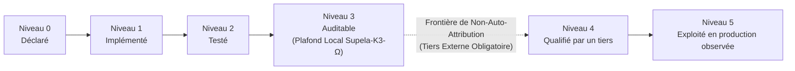
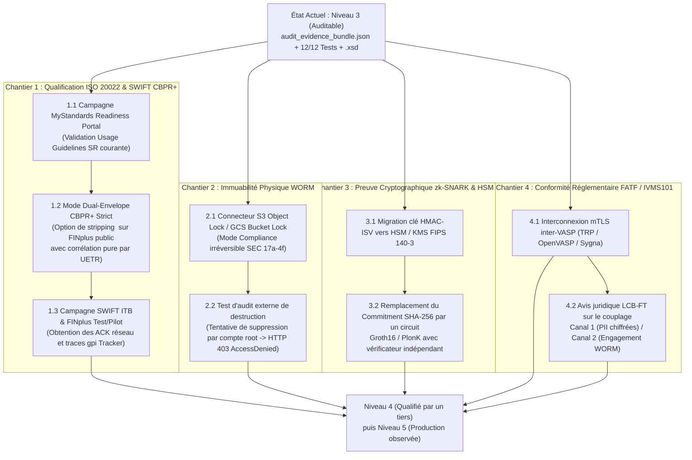

# Rapport d'Assurance & d'Audit : Supela‑EaaS‑K3‑Ω (`Supela‑2026‑Δ`)

> [!IMPORTANT]
> **Invariant d'Honnêteté Intellectuelle & Règle de Non‑Auto‑Attribution**
> *« Une capacité n'est pas une conformité. Une conformité n'est pas une acceptation. Une acceptation n'est pas une preuve. Une preuve n'est pas une garantie. »*
>
> **Principe Fondamental de Qualification :**
> *« Le bundle n'est pas la preuve de conformité. Le bundle est la preuve que la conformité peut être auditée. La qualification officielle (Niveau 4) et l'exploitation observée (Niveau 5) ne peuvent jamais être auto‑attribuées par le producteur du système ; elles ne peuvent être accordées que par l'écosystème externe concerné. »*

---

## 1. Tableau des Niveaux de Preuve (Échelle Méthodologique `Niveau 0` $\rightarrow$ `Niveau 5`)

Ce référentiel classe chaque composant selon sa force probante réelle. **Tout artefact produit et vérifié uniquement dans l'environnement local plafonne strictement au `Niveau 3 : Auditable`.**



| Niveau de Preuve | Définition Épistémique & Opposable | Autorité Émettrice de la Preuve | Risque Résiduel à ce Niveau | État Actuel de `Supela‑2026‑Δ` |
| :--- | :--- | :--- | :--- | :---: |
| **`Niveau 0 : Déclaré`** | Intention architecturale ou spécification décrite dans un document sans code exécutable associé. | Auteur / Architecte | Écart total possible entre le discours et la réalité logicielle. | Dépassé |
| **`Niveau 1 : Implémenté`** | Code source, schémas ou politiques présents dans le dépôt, sans démonstration d'exécution contradictoire. | Développeur | Bugs silencieux, chemins morts, validations complaisantes. | Dépassé |
| **`Niveau 2 : Testé`** | Chemins fonctionnels et cas d'erreur exercés localement par une suite de tests unitaires et d'intégration. | Environnement de test du producteur | L'auditeur doit encore faire confiance au producteur des logs de test. | Dépassé |
| **`Niveau 3 : Auditable`** *(Plafond Local Maximal)* | Artefacts, code, schémas et tests positifs/négatifs scellés dans un bundle reproductible permettant à un tiers de vérifier indépendamment qu'aucune preuve n'a été altérée. | **Protocole Clean‑Room & Vérificateur Hors‑Ligne** ([audit_evidence_bundle.json](file:///C:/Users/Group/.gemini/antigravity/scratch/supela-k3-omega/evidence/audit_evidence_bundle.json)) | **Conformité normative externe et immuabilité physique non établies.** | **ATTEINT (`12/12` tests + Fault Injection)** |
| **`Niveau 4 : Qualifié par un tiers`** | Conformité formellement attestée par les outils de certification officiels ou par un auditeur externe accrédité (auto‑attribution interdite). | **SWIFT MyStandards, ISO RMG/SEG, Auditeur Crypto/SOC 2, Autorité LCB‑FT** | Risque d'intégration ou de dérive lors du passage à l'échelle en réseau réel. | **NON DÉMONTRÉ (En attente du Plan Section 4)** |
| **`Niveau 5 : Exploité en production observée`** | Exécution réelle de bout en bout sur l'infrastructure réglementée, avec preuves d'observation remontées par les contreparties du réseau. | **Réseau SWIFT GPI / Tracker, Banques de Règlement, Réseau Inter‑VASP** | Risques opérationnels courants (gestion d'incidents, évolutions annuelles des *Standards Releases*). | **NON DÉMONTRÉ** |

---

## 2. Positionnement des Composants Supela‑K3‑Ω sur l'Échelle `0–5`

| Composant / Assertion | Niveau Actuel | Ce qui est Démontré au Niveau 3 (Auditable) | Ce qui Interdit la Promotion au Niveau 4 sans Tiers |
| :--- | :---: | :--- | :--- |
| **Passerelle d'aplatissement JSON (`schema_flattener.py`)** | **`Niveau 3 : Auditable`** | Suppression reproductible des cycles `$ref`/`$defs` et scellement des objets ouverts ([`test_03`](file:///C:/Users/Group/.gemini/antigravity/scratch/supela-k3-omega/tests/test_supela_k3_omega.py#L126-L152), [`test_04`](file:///C:/Users/Group/.gemini/antigravity/scratch/supela-k3-omega/tests/test_supela_k3_omega.py#L154-L167)). | Absence de télémétrie certifiée sur les endpoints de production Meta / OpenRouter. |
| **Proxy HTTP/MCP & Circuit‑Breaker (`k3_http_mcp_gateway.py`)** | **`Niveau 3 : Auditable`** | Interception HTTP locale réelle, capture d'un `429` simulé et repli vers `supela-local-sovereign-v1` ([`test_08`](file:///C:/Users/Group/.gemini/antigravity/scratch/supela-k3-omega/tests/test_supela_k3_omega.py#L215-L267)). | Le retour `429` est émis par le simulateur amont local, non par une API fournisseur externe. |
| **Journal WORM & Sceau `HMAC-ISV` (`worm_merkle.py`)** | **`Niveau 3 : Auditable`** | Détection déterministe d'une fausse clé ISV, d'une mutation mémoire ou d'un octet altéré dans le bundle ([`test_09`](file:///C:/Users/Group/.gemini/antigravity/scratch/supela-k3-omega/tests/test_supela_k3_omega.py#L273-L319)). | Stockage sur système de fichiers standard modifiable par un administrateur système (pas de verrou matériel WORM). |
| **Engagement `Commitment-Witness` (`worm_merkle.py`)** | **`Niveau 3 : Auditable`** | Rejet mathématique d'un témoin (`witness`) falsifié via `SHA-256` ([`test_10`](file:///C:/Users/Group/.gemini/antigravity/scratch/supela-k3-omega/tests/test_supela_k3_omega.py#L321-L339)). | Il s'agit d'un schéma d'engagement par hachage, et non d'une preuve zk‑SNARK sur circuit arithmétique. |
| **Miroirs ISO 20022 (`pacs.008`, `camt.053`) & Extension `.xsd`** | **`Niveau 3 : Auditable`** | Validation locale de séquence XSD, BICFI, ISO 4217 et isolation de [supela_splmtry_001_001_01.xsd](file:///C:/Users/Group/.gemini/antigravity/scratch/supela-k3-omega/schemas/supela_splmtry_001_001_01.xsd) ([`test_07`](file:///C:/Users/Group/.gemini/antigravity/scratch/supela-k3-omega/tests/test_supela_k3_omega.py#L188-L213), [`test_12`](file:///C:/Users/Group/.gemini/antigravity/scratch/supela-k3-omega/tests/test_supela_k3_omega.py#L362-L394)). | Extension propriétaire non enregistrée auprès d'ISO 20022 RMG/SEG ; non soumise à un validateur bancaire tiers. |
| **En-tête BAH (`head.001`), UETR & Profil SWIFT CBPR+** | **`Niveau 3 : Auditable`** | Format UUIDv4 et blocage local du rejeu d'un couple `(proposal_id, parent_hash)` ([`test_11`](file:///C:/Users/Group/.gemini/antigravity/scratch/supela-k3-omega/tests/test_supela_k3_omega.py#L341-L360)). | **Aucune qualification SWIFT CBPR+ démontrée** (voir les 6 critères obligatoires en Section 3). |
| **Miroir Bi‑Canal FATF Travel Rule (`IVMS101`)** | **`Niveau 3 : Auditable`** | Séparation structurelle entre le Canal 1 (attributs IVMS101 complets) et le Canal 2 (engagement zéro‑PII WORM). | Aucun canal mTLS inter‑VASP actif ni validation juridique par un régulateur LCB‑FT. |

---

## 3. Critères de Qualification Officielle SWIFT CBPR+ & Statut du « Candidat UETR »

> [!WARNING]
> **Formulation Opposable sur le Candidat UETR :**
> *« Le générateur Supela produit un identifiant au format UUIDv4 destiné à être utilisé comme **candidat UETR**. La reconnaissance de cet identifiant comme UETR conforme CBPR+ demeure conditionnée à la vérification de son unicité opérationnelle, de sa non‑réutilisation, de sa persistance dans la chaîne de paiement et de sa conformité aux Usage Guidelines SWIFT applicables. »*

$$\text{UUIDv4 valide} \neq \text{UETR conforme CBPR+}$$

$$\text{UETR conforme CBPR+} = \text{UUIDv4 valide} + \text{Unicité} + \text{Non-réutilisation} + \text{Persistance interbancaire} + \text{Respect des Usage Guidelines} + \text{Validation réseau SWIFT}$$

### 3.1 Décomposition Fine du Statut UETR (Génération vs Conformité vs Qualification)

Cette grille — désormais encodée directement dans chaque enveloppe miroir (`uetr_status_breakdown` dans [iso_fatf_mirrors.py](file:///C:/Users/Group/.gemini/antigravity/scratch/supela-k3-omega/src/iso_fatf_mirrors.py#L245-L270)) — interdit tout glissement sémantique entre format, implémentation, conformité et acceptation réseau :

| Assertion | Statut Actuel | Justification & Preuve Associée |
| :--- | :---: | :--- |
| **1. UUIDv4 généré** | **`Démontrable localement`** | Format RFC 4122 (36 caractères, version `4`, variant `89ab`) vérifié par regex et tests unitaires. |
| **2. Candidat UETR produit** | **`Démontrable localement`** | Émis par [`UetrUniquenessRegistry`](file:///C:/Users/Group/.gemini/antigravity/scratch/supela-k3-omega/src/iso_fatf_mirrors.py#L46-L71) avec blocage local de réutilisation (`test_11`). |
| **3. Respect syntaxique ISO** | **`Vérifiable localement`** | Balise `<PmtId><UETR>` positionnée selon la séquence XSD `pacs.008.001.10` (`test_07`, `test_12`). |
| **4. Respect Usage Guidelines CBPR+** | **`À valider`** | Requiert l'inspection du message complet sur les règles de restriction CBPR+ de la Standards Release active. |
| **5. Qualification SWIFT CBPR+** | **`Non démontré`** | Requiert un rapport sans erreur issu du portail officiel **SWIFT MyStandards Readiness Portal** / **ITB**. |
| **6. Persistance interbancaire observée** | **`Non démontré`** | Requiert l'observation du même UETR conservé sans altération à travers plusieurs banques (`DbtrAgt` $\rightarrow$ `IntrmyAgt` $\rightarrow$ `CdtrAgt`). |
| **7. Validation réseau SWIFT / GPI** | **`Non démontré`** | Requiert des accusés réseau FINplus et des événements remontés par le **SWIFT gpi Tracker** (`trck.001`). |

### 3.2 Les 6 Preuves Externes Obligatoires pour Débloquer les Niveaux 4 et 5

Pour promouvoir le statut de `Niveau 3 (Auditable)` vers `Niveau 4 (Qualifié)` puis `Niveau 5 (Exploité en production observée)`, **six preuves issues de l'infrastructure SWIFT elle‑même** sont obligatoires :

| # | Critère Externe Obligatoire | Nature de la Preuve Attendue | Niveau Débloqué | État Actuel |
| :---: | :--- | :--- | :---: | :---: |
| **C1** | **Validation sur les outils officiels CBPR+ (*SWIFT MyStandards Readiness Portal*)** | Rapport d'inspection exporté depuis **MyStandards** attestant de `0 Error / 0 Violation` contre les *CBPR+ Usage Guidelines* de la Standards Release (SR) en vigueur (règles de troncature, jeu de caractères FIN‑X, cardinalités restreintes, règles formelles inter‑champs). | **Niveau 4** | Non fourni |
| **C2** | **Qualification de la combinaison `BAH (head.001.001.02)` + `Document` + `<BizSvc>`** | Preuve d'acceptation de l'enveloppe complète (`swift.cbprplus.02` ou `swift.cbprplus.stp.02`) sur le banc d'essai officiel **SWIFT Integration Testbed (ITB)**, vérifiant notamment que la présence ou l'absence de `<SplmtryData>` respecte les restrictions strictes du profil CBPR+ ciblé. | **Niveau 4** | Non fourni |
| **C3** | **Exécution sur un environnement SWIFT autorisé (*FINplus Pilot / Test & Training*)** | Journaux d'émission/réception signés par une interface **SWIFT Alliance Access / AMH** ou un **Service Bureau SWIFT** agréé, avec accusés réseau (`ACK` de niveau réseau FINplus / InterAct). | **Niveau 4** | Non fourni |
| **C4** | **Acceptation bilatérale ou retrait de `<SupplementaryData>` sur le flux CBPR+ public** | Comme CBPR+ restreint l'usage de `<SplmtryData>` dans les flux généraux : soit preuve d'un accord bilatéral/Market Practice enregistré autorisant `urn:supela:std:k3:omega:xsd:splmtry.001.001.01`, soit preuve que la passerelle Supela détache `<SplmtryData>` avant injection sur FINplus tout en conservant le lien par `UETR` dans le registre WORM. | **Niveau 4** | Non fourni |
| **C5** | **Conservation du même UETR à travers plusieurs établissements (*End-to-End Persistence*)** | Traces corrélées montrant un message `pacs.008` émis par l'établissement A (`DbtrAgt`), relayé par une banque correspondante intermédiaire B (`IntrmyAgt1`), et réglé ou confirmé par l'établissement C (`CdtrAgt`) via `pacs.002` / `camt.054` / `camt.053` **en conservant exactement le même UETR sans régénération ni collision**. | **Niveau 5** | Non fourni |
| **C6** | **Observations remontées par le *SWIFT gpi Tracker* (`trck.001` / API Tracker)** | Preuve externe indépendante extraite du **SWIFT gpi Tracker** (statuts `ACSP`, `ACSC` ou `RJCT`, horodatages interbancaires, frais prélevés et confirmation de crédit final) associée à l'UETR généré. | **Niveau 5** | Non fourni |

---

## 4. Plan de Validation Externe (Feuille de Route `Niveau 3` $\rightarrow$ `Niveau 4` $\rightarrow$ `Niveau 5`)

Ce plan opérationnel structure les cinq chantiers externes nécessaires pour transformer l'**auditabilité locale (Niveau 3)** en **qualification par des tiers (Niveau 4)** puis en **exploitation observée (Niveau 5)**.



### Détail des Livrables par Chantier Externe

1. **Chantier 1 — Homologation ISO 20022 & SWIFT CBPR+** :
   * **Action technique préalable** : Ajouter dans [`NormativeMirrorCompiler`](file:///C:/Users/Group/.gemini/antigravity/scratch/supela-k3-omega/src/iso_fatf_mirrors.py#L179-L294) un commutateur `cbpr_plus_strict_strip_splmtry: bool` permettant d'émettre sur le réseau SWIFT public un `pacs.008` strictement dépourvu de `<SplmtryData>` (pour éviter tout rejet CBPR+ sur extension non enregistrée), tout en archivant le bloc `<SupelaLineage>` en interne indexé par l'`UETR`.
   * **Preuve de sortie (Niveau 4)** : Certificat d'essai **SWIFT ITB** et rapport PDF/JSON **MyStandards**.
   * **Preuve de sortie (Niveau 5)** : Trace complète d'un cycle `pacs.008` $\rightarrow$ `pacs.002` / `trck.001` à travers deux BIC distincts sur **SWIFT gpi Tracker**.
2. **Chantier 2 — Qualification du Stockage Physique WORM** :
   * **Action technique** : Brancher [`SupelaWormLedger.append_sealed_event`](file:///C:/Users/Group/.gemini/antigravity/scratch/supela-k3-omega/src/worm_merkle.py#L156-L178) sur un compartiment cloud configuré en **Object Lock — Mode Compliance** avec période de rétention légale verrouillée.
   * **Preuve de sortie (Niveau 4)** : Rapport d'audit d'infrastructure prouvant l'échec d'une commande `DeleteObject` / `PutObjectRetention` exécutée avec les privilèges administrateur maximaux.
3. **Chantier 3 — Qualification Cryptographique Indépendante (HSM & ZKP)** :
   * **Action technique** : Déporter la clé `ISV-KEY-2026-DELTA-SOVEREIGN-01` dans un module matériel **HSM / Cloud KMS (FIPS 140‑3)** et formaliser le prédicat de conformité dans un circuit arithmétique (`circom` / `halo2` / `gnark`).
   * **Preuve de sortie (Niveau 4)** : Vérification hors-ligne d'une preuve `Groth16`/`PlonK` via une clé de vérification publique (`verification_key.json`) par un auditeur cryptographique tiers.
4. **Chantier 4 — Qualification Réglementaire FATF Rec. 16 / IVMS101** :
   * **Action technique** : Connecter le `channel_1_inter_vasp_travel_rule_payload` à un protocole de transport Travel Rule standardisé (ex. *Travel Rule Protocol - TRP*) avec chiffrement de bout en bout entre deux VASP.
   * **Preuve de sortie (Niveau 4)** : Validation par le département Conformité / Audit LCB‑FT de l'établissement assujetti.

---

## 5. Artefacts Locaux Scellés & Protocole Clean‑Room (Niveau 3)

* **Schéma XSD propriétaire d'extension bilatérale** : [supela_splmtry_001_001_01.xsd](file:///C:/Users/Group/.gemini/antigravity/scratch/supela-k3-omega/schemas/supela_splmtry_001_001_01.xsd) (`urn:supela:std:k3:omega:xsd:splmtry.001.001.01`).
* **Bundle d'évidence d'audit statique signé (`Niveau 3 : Auditable`)** : [audit_evidence_bundle.json](file:///C:/Users/Group/.gemini/antigravity/scratch/supela-k3-omega/evidence/audit_evidence_bundle.json)
  * Généré et vérifié par [generate_audit_bundle.py](file:///C:/Users/Group/.gemini/antigravity/scratch/supela-k3-omega/src/generate_audit_bundle.py) (`bundle_payload_sha256: sha256:d2e1ffa8e4615025a60d0049d2ddfa512b1ae2964a9443923674dc74691c81ee`).
  * Intègre explicitement l'échelle `LEVEL_0_DECLARED` $\rightarrow$ `LEVEL_5_OBSERVED_IN_PRODUCTION` avec `"local_ceiling_enforced": "LEVEL_3_AUDITABLE"` et `"self_attribution_of_level_4_or_5": false`.
* **Commandes de vérification contradictoire (Protocole *Clean‑Room*)** :
  ```powershell
  # 1. Exécution des 12 tests (8 fonctionnels + 4 négatifs d'audit)
  python tests/test_supela_k3_omega.py

  # 2. Régénération et vérification hors-ligne du bundle signé
  python src/generate_audit_bundle.py

  # 3. Injection de fautes (mauvaise clé ISV et altération d'un octet)
  python -c "from pathlib import Path; from src.generate_audit_bundle import verify_audit_evidence_bundle; p = Path('evidence/audit_evidence_bundle.json'); print('Nominal:', verify_audit_evidence_bundle(p)); print('Wrong key:', verify_audit_evidence_bundle(p, b'AUDITOR_RANDOM_WRONG_KEY_1234567'))"
  ```

---

## 6. Conclusion d'Audit Finale (Formulation Opposable)

> **Déclaration Finale d'Assurance et de Portée (`Supela‑2026‑Δ / K3‑Ω`)**
>
> Les contrôles additionnels démontrent la capacité du système à produire, sceller, vérifier et soumettre à audit un ensemble d'artefacts relatifs aux profils ISO 20022 (`pacs.008`, `camt.053`), SWIFT CBPR+ (`head.001.001.02`, UETR avec registre anti-rejeu) et FATF/IVMS101 (modèle bi-canal) visés. Ils démontrent également la détectabilité d'altérations du bundle d'évidence ([audit_evidence_bundle.json](file:///C:/Users/Group/.gemini/antigravity/scratch/supela-k3-omega/evidence/audit_evidence_bundle.json)) et du journal en mémoire dans le périmètre testé (`12/12` tests unitaires et contradictoires).
>
> Sur l'échelle méthodologique d'assurance en six niveaux (`Niveau 0 : Déclaré` à `Niveau 5 : Exploité en production observée`), ces éléments établissent le passage du système du **`Niveau 2 : Testé`** au **`Niveau 3 : Auditable`**.
>
> Ils ne constituent pas une preuve de qualification officielle SWIFT CBPR+ (**`Niveau 4`**), de persistance d'UETR observée à travers plusieurs établissements sur le réseau interbancaire (**`Niveau 5`**), d'immuabilité physique du support de stockage WORM, de preuve à divulgation nulle sur circuit arithmétique, ni d'acceptation par une infrastructure réglementée. Conformément au principe selon lequel **une qualification officielle ne peut jamais être auto‑attribuée**, ces propriétés demeurent strictement conditionnées à l'exécution du plan de validation externe (Section 4) auprès des autorités, plateformes et infrastructures compétentes.
