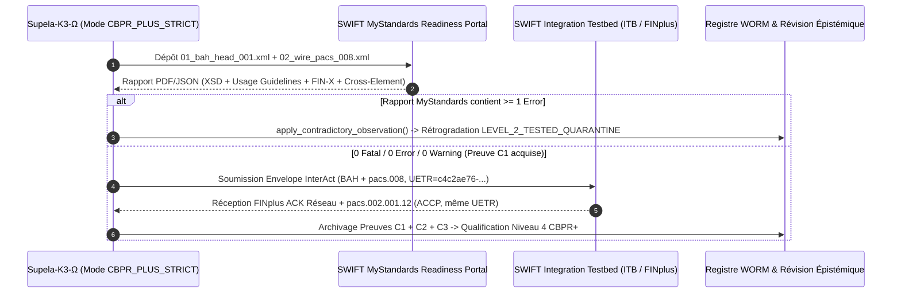

# Plan Officiel de Qualification `SWIFT CBPR+` & de Certification Cryptographique (`KMS/HSM + ZKP`) — Transition `N3 → N4`

> [!IMPORTANT]
> **Règle d'Or de Franchissement du `Niveau 4 — Qualifié par un Tiers` :**
> Conformément à l'invariant de `Supela‑K3‑Ω` (*« Les autres systèmes cherchent à prouver qu’ils fonctionnent. Supela cherche aussi à prouver qu’ils ont le droit de le prétendre »*), **aucune exécution locale ne peut promouvoir un composant au `LEVEL_4_THIRD_PARTY_QUALIFIED`**.
> La promotion du `Niveau 3` au `Niveau 4` exige le dépôt du **Pack de Soumission Autonome** ([`evidence/mystandards_submission_pack/`](file:///C:/Users/Group/.gemini/antigravity/scratch/supela-k3-omega/evidence/mystandards_submission_pack/SUBMISSION_MANIFEST.json)) auprès d'autorités ou d'environnements de validation externes indépendants, et l'archivage de leurs **rapports signés** en retour. En cas d'échec ou de rejet (`NACK`), le moteur applique obligatoirement [`apply_contradictory_observation()`](file:///C:/Users/Group/.gemini/antigravity/scratch/supela-k3-omega/src/supela_k3_engine.py#L387-L435) pour rétrograder l'état au `LEVEL_2_TESTED_QUARANTINE`.

---

## 1. Dossier de Soumission Extrait & Prêt au Dépôt (`mystandards_submission_pack`)

L'utilitaire [`export_mystandards_itb_package.py`](file:///C:/Users/Group/.gemini/antigravity/scratch/supela-k3-omega/src/export_mystandards_itb_package.py) extrait automatiquement depuis le bundle scellé ([`audit_evidence_bundle.json`](file:///C:/Users/Group/.gemini/antigravity/scratch/supela-k3-omega/evidence/audit_evidence_bundle.json)) les 5 fichiers autonomes destinés aux portails tiers :

| Fichier Extrait | Empreinte `SHA‑256` | Destinataire Tiers | Rôle dans la Qualification `N4` |
| :--- | :--- | :--- | :--- |
| [`01_bah_head_001_001_02_strict.xml`](file:///C:/Users/Group/.gemini/antigravity/scratch/supela-k3-omega/evidence/mystandards_submission_pack/01_bah_head_001_001_02_strict.xml) | `sha256:29007dc7545bc94f...d55d05` | **SWIFT MyStandards & ITB** | Business Application Header (`head.001.001.02`, service `swift.cbprplus.02`). |
| [`02_wire_pacs_008_001_10_strict.xml`](file:///C:/Users/Group/.gemini/antigravity/scratch/supela-k3-omega/evidence/mystandards_submission_pack/02_wire_pacs_008_001_10_strict.xml) | `sha256:c21ed30e86ab8875...54bb8d` | **SWIFT MyStandards & ITB** | Message réseau `pacs.008.001.10` en mode `CBPR_PLUS_STRICT` (**zéro `<SplmtryData>`**, `SttlmMtd=INDA`, `InstgAgt`/`InstdAgt` présents). |
| [`03_wire_camt_053_001_10.xml`](file:///C:/Users/Group/.gemini/antigravity/scratch/supela-k3-omega/evidence/mystandards_submission_pack/03_wire_camt_053_001_10.xml) | `sha256:bbee22fb47e0dd86...d1aec` | **SWIFT MyStandards** | Relevé de compte bancaire de fin de journée (`camt.053.001.10`). |
| [`04_detached_supela_lineage_sidecar.xml`](file:///C:/Users/Group/.gemini/antigravity/scratch/supela-k3-omega/evidence/mystandards_submission_pack/04_detached_supela_lineage_sidecar.xml) | `sha256:06164ea289a9b1cf...fdd06` | **Auditeur Cryptographique & Contrepartie Bilatérale** | Sidecar `<SupelaLineage>` hors réseau SWIFT, liant le message `pacs.008` à `SUP-0` via `<BoundUETR>` et `<BoundWirePackageSha256>`. |
| [`05_schnorr_2048_nizk_proof_vector.json`](file:///C:/Users/Group/.gemini/antigravity/scratch/supela-k3-omega/evidence/mystandards_submission_pack/05_schnorr_2048_nizk_proof_vector.json) | `sha256:ae0b1b561d797fbf...81677` | **Auditeur Cryptographique Tiers** | Vecteur de preuve $\Sigma$ Schnorr NIZK 2048 bits (RFC 3526 Groupe 14) vérifiable sans accès au code Supela. |

---

## 2. Volet I — Plan de Qualification Officielle `SWIFT CBPR+` (`MyStandards` & `ITB`)

### 2.1 Étape 1 : Protocole de Dépôt sur le **SWIFT MyStandards Readiness Portal** (Preuve `C1`)

1. **Sélection du Profil Normatif sur le Portail** :
   * Groupe de standards : `CBPR+ (Cross-Border Payments and Reporting Plus)` — Standard Release en vigueur.
   * Usage Guideline ciblée : `CBPRPlus_ISO_20022_Portfolio -> pacs.008.001.08 / pacs.008.001.10 (FIToFICustomerCreditTransfer)` combinée avec `BusinessApplicationHeaderV02 (head.001.001.02)`.
2. **Contrôles Formels Exécutés par le Moteur MyStandards** :
   * **Absence d'élément élagué (*Pruned Element Check*)** : Vérifie que `<SplmtryData>` est absent de `<CdtTrfTxInf>` (garanti par notre mode `CBPR_PLUS_STRICT` sur [`02_wire_pacs_008_001_10_strict.xml`](file:///C:/Users/Group/.gemini/antigravity/scratch/supela-k3-omega/evidence/mystandards_submission_pack/02_wire_pacs_008_001_10_strict.xml)).
   * **Règle inter‑champs `CBPR_SettlementMethod_Agent_Rule`** : Avec `<SttlmMtd>INDA</SttlmMtd>`, présence simultanée et valide de `<InstgAgt>`, `<InstdAgt>`, `<DbtrAgt>` et `<CdtrAgt>`.
   * **Règle `CBPR_CharacterSet_FINX`** : Aucun identifiant (`MsgId`, `InstrId`, `EndToEndId`, `BizMsgIdr`) ne dépasse 35 caractères ni ne commence/termine par `/`.
   * **Règle `CBPR_UETR_Format`** : Validation RFC 4122 UUIDv4 en minuscules (`c4c2ae76-d6e6-4af2-9503-07557f342cf9`).
3. **Critère d'Acceptation (`Gate 1`)** :
   * Obtention d'un rapport d'export MyStandards affichant **`0 Fatal / 0 Error / 0 Warning`**.

### 2.2 Étape 2 : Protocole d'Exécution sur le **SWIFT Integration Testbed (ITB)** (Preuves `C2` & `C3`)

1. **Scénario de Test ITB** :
   * Injection de l'enveloppe `RequestPayload` contenant [`01_bah_head_001_001_02_strict.xml`](file:///C:/Users/Group/.gemini/antigravity/scratch/supela-k3-omega/evidence/mystandards_submission_pack/01_bah_head_001_001_02_strict.xml) et [`02_wire_pacs_008_001_10_strict.xml`](file:///C:/Users/Group/.gemini/antigravity/scratch/supela-k3-omega/evidence/mystandards_submission_pack/02_wire_pacs_008_001_10_strict.xml) sur le banc d'essai SWIFT ITB.
   * Remplacement des BIC de test par les BIC de test officiels attribués à l'institution sur le bac à sable ITB (car l'annuaire BIC Directory ITB vérifie l'existence réelle du BIC8/BIC11 connecté).
2. **Critères d'Acceptation (`Gate 2`)** :
   * **Preuve `C2`** : Trace réseau `FINplus ACK` (`TransmissionReport` positif sans code d'erreur `H001`/`XSD`).
   * **Preuve `C3`** : Réception du message de statut retour `pacs.002.001.12` (*FIToFIPaymentStatusReport*) généré par le simulateur ITB avec `<TxSts>ACCP</TxSts>` (ou `ACSC`) et `<OrgnlUETR>c4c2ae76-d6e6-4af2-9503-07557f342cf9</OrgnlUETR>` strictement identique au candidat UETR émis.

### 2.3 Étape 3 : Enregistrement Bilatéral du *Sidecar* `<SupelaLineage>` (Preuve `C4`)

* Pour les contreparties bancaires qui souhaitent vérifier la lignée `SUP-0` et la preuve ZKP sans polluer le réseau SWIFT FINplus :
  * La banque reçoit le flux SWIFT standard (`01_bah` + `02_wire_pacs_008`) sur FINplus.
  * Elle reçoit en parallèle (ou consulte via API d'audit) le fichier [`04_detached_supela_lineage_sidecar.xml`](file:///C:/Users/Group/.gemini/antigravity/scratch/supela-k3-omega/evidence/mystandards_submission_pack/04_detached_supela_lineage_sidecar.xml) et vérifie :
    1. Sa conformité au schéma XSD [`supela_splmtry_001_001_01.xsd`](file:///C:/Users/Group/.gemini/antigravity/scratch/supela-k3-omega/schemas/supela_splmtry_001_001_01.xsd).
    2. L'égalité `<BoundUETR> == pacs.008//UETR`.
    3. L'égalité `<BoundWirePackageSha256> == SHA256(bah_xml + "|" + pacs008_xml)`.

---

## 3. Volet II — Plan de Certification Cryptographique (`KMS/HSM + ZKP + WORM`)

### 3.1 Audit Indépendant du Protocole $\Sigma$ Schnorr NIZK 2048 bits (`Gate 3A`)

L'auditeur cryptographique tiers n'a pas besoin de faire confiance au code Python de Supela. Il prend uniquement le fichier [`05_schnorr_2048_nizk_proof_vector.json`](file:///C:/Users/Group/.gemini/antigravity/scratch/supela-k3-omega/evidence/mystandards_submission_pack/05_schnorr_2048_nizk_proof_vector.json) et vérifie dans son propre outil mathématique (SageMath, OpenSSL, Go `math/big`, Rust) les 4 propriétés suivantes sur le groupe **IETF RFC 3526 Groupe 14** ($p$ premier sûr de 2048 bits, $q = (p-1)/2$ premier de Sophie Germain, générateur $g = 4$) :

1. **Appartenance au sous‑groupe d'ordre premier $q$** (élimine les attaques de petits sous‑groupes de Pohlig‑Hellman) :
   $$1 < Y < p-1, \quad Y^q \equiv 1 \pmod p, \quad 1 < R < p-1, \quad R^q \equiv 1 \pmod p$$
2. **Recalcul déterministe du défi Fiat‑Shamir $c$** :
   $$c = \operatorname{SHA256}\left(\text{"SUPELA-SCHNORR-NIZK-RFC3526-V1|"} \;\|\; g_{\text{hex}} \;\|\; Y_{\text{hex}} \;\|\; R_{\text{hex}} \;\|\; \text{context\_binding}\right) \bmod q$$
3. **Équation algébrique de vérification de Schnorr** :
   $$g^s \bmod p \stackrel{?}{=} (R \cdot Y^c) \bmod p$$
4. **Extension vers un Circuit Arithmétique `zk-SNARK` (`Groth16` / `PlonK`) pour Prédicats Complexes** :
   * Alors que la preuve Schnorr 2048 bits prouve en divulgation nulle la connaissance du témoin d'autorisation $w$ lié au bloc parent `SUP-0`, le passage au niveau supérieur pour le criblage LCB‑FT (`VR-15`) consiste à compiler un circuit arithmétique Circom/Halo2 prouvant que $\text{Hash}(\text{Originator\_PII}) \notin \text{Sanctions\_Merkle\_Tree}$ sans révéler les PII.

### 3.2 Séquestration Matérielle des Clés (`HSM / Cloud KMS FIPS 140-3 Level 3`) (`Gate 3B`)

Pour passer du `Niveau 3` (clé CSPRNG éphémère en RAM + signature GPG locale) au `Niveau 4` (séquestration matérielle certifiée) :

| Composant Actuel (`Niveau 3` / `Epsilon`) | Cible `Niveau 4` Certifiée | Preuve Externe Requise pour l'Auditeur |
| :--- | :--- | :--- |
| **Clé HMAC-ISV CSPRNG 256 bits en RAM** ([`worm_merkle.py`](file:///C:/Users/Group/.gemini/antigravity/scratch/supela-k3-omega/src/worm_merkle.py)) | **Clé asymétrique ECDSA P‑256 / Ed25519 ou HMAC séquestrée dans un HSM FIPS 140‑3 Niveau 3** (AWS CloudHSM, GCP Cloud KMS HSM, Thales Luna) avec attribut `Exportable = False`. | Journal d'audit KMS + attestation matérielle de clé (`Key Attestation Statement` signé par la racine matérielle du fabricant HSM). |
| **Vérification d'absence de TPM signalée** | **Attestation matérielle TPM 2.0 réelle (`tpm2_quote`)** sur les registres PCR `0..7` (BIOS/UEFI/Bootloader) et PCR `14` (binaire `opa.exe` + moteur K3). | Signature `TPM2_Quote` vérifiée contre le certificat d'Endorsement Key (`EKCert`) du fondeur TPM. |
| **Journal WORM chaîné en mémoire** | **Persistance sur stockage immuable S3 Object Lock / GCS Bucket Lock en mode `COMPLIANCE`** (conforme SEC Rule 17a‑4(f) / FINRA 4511). | **Trace contradictoire d'échec Root** : journal CloudTrail montrant une requête `DeleteObject` / `PutObjectRetention` émise par le compte `Root` et rejetée par `HTTP 403 AccessDenied`. |

---

## 4. Matrice de Déverrouillage `LEVEL_3_AUDITABLE` $\rightarrow$ `LEVEL_4_THIRD_PARTY_QUALIFIED`

Conformément au gouverneur épistémique de [`supela_k3_engine.py`](file:///C:/Users/Group/.gemini/antigravity/scratch/supela-k3-omega/src/supela_k3_engine.py#L338-L370), le passage d'une ligne de `LEVEL_3_AUDITABLE` à `LEVEL_4_THIRD_PARTY_QUALIFIED` n'est autorisé que lorsque l'artefact tiers correspondant est présent et vérifié :

| Composant de `epistemic_assurance_matrix` | Statut Actuel (`Epsilon`) | Artefact Tiers Exigé pour Promouvoir en `LEVEL_4` | Réaction Automatique en Cas d'Échec Tiers |
| :--- | :---: | :--- | :--- |
| **`iso20022_cbpr_plus_compliance`** | `LEVEL_3_AUDITABLE` (`CBPR_PLUS_STRICT`) | Rapport MyStandards `0 Error` sur `01_bah` + `02_wire_pacs_008` **ET** trace `FINplus ACK` + `pacs.002 ACCP` sur SWIFT ITB. | `apply_contradictory_observation()` $\rightarrow$ `LEVEL_2_TESTED_QUARANTINE` + bloc WORM `K3_EPISTEMIC_DEMOTION`. |
| **`zkp_validity`** | `LEVEL_3_AUDITABLE` (`SCHNORR_2048_MODP_NIZK_VERIFIED`) | Rapport d'audit cryptographique tiers sur `05_schnorr_2048_nizk_proof_vector.json` + clé de vérification zk‑SNARK auditée. | `apply_contradictory_observation()` $\rightarrow$ `LEVEL_1_IMPLEMENTED` + mise en quarantaine. |
| **`worm_ledger_immutability`** | `LEVEL_3_AUDITABLE` (`TAMPER_EVIDENT_IN_MEMORY`) | Attestation HSM FIPS 140‑3 (`Exportable=False`) + preuve CloudTrail de rejet `HTTP 403` sur suppression Root d'un bloc Object Lock `COMPLIANCE`. | `apply_contradictory_observation()` $\rightarrow$ `LEVEL_2_TESTED_QUARANTINE`. |
| **`fatf_travel_rule_ivms101`** | `LEVEL_3_AUDITABLE` (`DUAL_CHANNEL_MODEL_AUDITABLE`) | Handshake mTLS inter‑VASP (TRP / OpenVASP) réussi sur Canal 1 + validation juridique LCB‑FT du Canal 2 zéro‑PII. | `apply_contradictory_observation()` $\rightarrow$ `LEVEL_1_IMPLEMENTED`. |
| **`schema_flattening`** | `LEVEL_3_AUDITABLE` (`DEMONSTRATED_LOCALLY`) | Trace d'exécution live `HTTP 200` signée d'un appel d'outil MCP aplati sur le point de terminaison de production Meta Llama / OpenRouter. | `apply_contradictory_observation()` $\rightarrow$ `LEVEL_2_TESTED_QUARANTINE`. |
