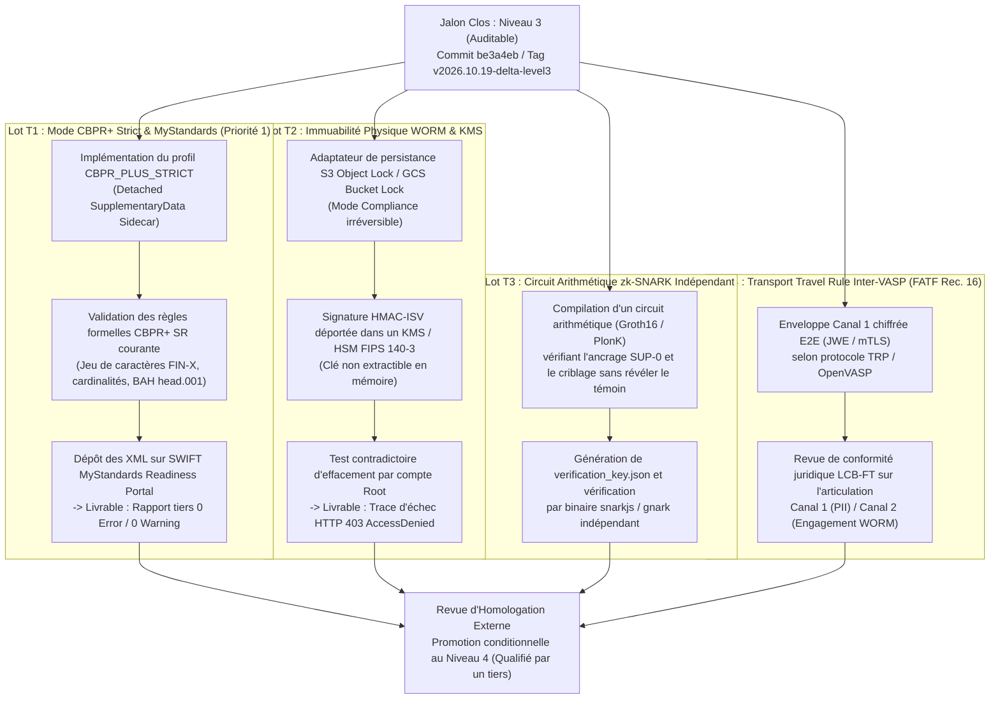
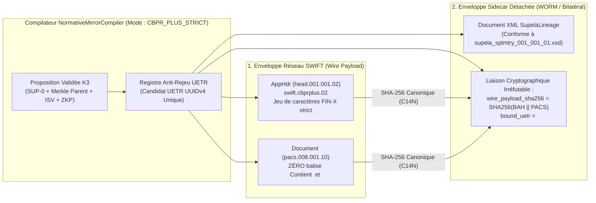

# Clôture du Jalon `Niveau 3` & Spécification de Transition vers le `Niveau 4` (`Supela‑K3‑Ω`)

---

## 1. Acte de Clôture Officielle du Jalon `Niveau 3 — Auditable`

> [!IMPORTANT]
> **Gel Canonique du Jalon `Niveau 3 — Auditable` (`v2026.10.19-delta-level3`)**
> Le jalon **`Supela‑2026‑Delta (Niveau 3 — Auditable)`** est officiellement **clos et gelé** à compter de cet acte.
> Conformément à la discipline d'immuabilité documentaire de `Supela‑K3‑Ω`, **aucun fichier, test ou condensat de la branche `supela-2026-delta-level3` ne doit plus être modifié**. Toute évolution ultérieure visant le `Niveau 4` devra obligatoirement s'effectuer sur une branche distincte (`supela-2026-epsilon-level4-prep`) chaînée à l'état figé ci-dessous.

### 1.1 Registre d'État Figé (Baseline Immuable `Niveau 3`)

| Paramètre de Scellement | Valeur Figée de Référence | Statut de Clôture |
| :--- | :--- | :---: |
| **Tag Annoté Signé GPG** | `v2026.10.19-delta-level3` (Objet Git `e57bd03`) | **VERROUILLÉ** |
| **Commit Git Signé GPG** | `be3a4eb3cef8e0fecc7e6dac7161e2e2b79b6e59` | **`Verified: true` (GitHub API)** |
| **Clé Publique GPG Ed25519** | `962E7595BA84F3422646093F83830D7037197404` (`ed25519/83830D7037197404`) | **Enregistrée & Active** |
| **Bundle d'Évidence (`SHA‑256`)** | `sha256:c88339702c8a7af4561b6f7894413b9755ecdf22cb2265d28a0fd4cad935d584` | **Scellé (`12/12` Tests)** |
| **Signature `HMAC‑ISV` du Bundle** | `isv-hmac-sha256:855cc890f34a641ed6d4e8c44f4345a8e31667df0813d7766188923824ea484c` | **Vérifiée Hors‑Ligne** |
| **Racine de Merkle WORM (`SUP‑0`)** | `sha256:b5572bea8bcb06db46411d8d959ccf26164f8a43cc01075b760c9666db8071f6` | **Intègre (5 Blocs)** |
| **Plafond Épistémique Runtime** | `LEVEL_3_AUDITABLE` (`self_attribution_of_level_4_or_5: false`) | **Appliqué en Code** |
| **URL de la Release Scellée** | `https://github.com/gadboisjean1000-arch/Supela-K3-Omega/releases/tag/v2026.10.19-delta-level3` | **Publiée** |

---

## 2. Plan de Transition `Niveau 3 (Auditable)` $\rightarrow$ `Niveau 4 (Qualifié par un Tiers)`

> [!NOTE]
> **Principe Directeur de la Transition :**
> Le passage du `Niveau 3` au `Niveau 4` ne consiste pas à « déclarer » le code conforme, mais à **éliminer les motifs de rejet des validateurs tiers officiels** (SWIFT MyStandards, stockage cloud Object Lock, vérificateur cryptographique indépendant, protocole inter‑VASP) afin d'obtenir des **preuves externes signées par ces tiers**.

### 2.1 Séquence des 4 Lots de Transition (`Branche Cible : supela-2026-epsilon-level4-prep`)



### 2.2 Grille de Passage des Portes (`Gate Criteria Niveau 3` $\rightarrow$ `Niveau 4`)

| Lot | Condition Technique Préalable (Code `Supela`) | Preuve Externe Obligatoire (Tiers Indépendant) | Critère d'Arrêt (*Fail-Closed*) |
| :--- | :--- | :--- | :--- |
| **Lot T1 (CBPR+)** | Activer le mode `CBPR_PLUS_STRICT` (retrait de `<SplmtryData>` sur le flux réseau public). | Rapport d'évaluation **SWIFT MyStandards** et accusé **SWIFT ITB** avec `0 Error`. | Tant que le rapport MyStandards n'est pas joint au bundle, le runtime maintient `level = LEVEL_3_AUDITABLE`. |
| **Lot T2 (WORM)** | Écrire chaque `WormEntry` dans un bucket doté d'`Object Lock (Compliance)` et signer via KMS/HSM. | Capture d'audit cloud montrant la politique `COMPLIANCE` active et le rejet d'un `DeleteObject` root. | Si le backend est un disque local ou un bucket sans `Object Lock`, le statut reste `TAMPER_EVIDENT_IN_MEMORY`. |
| **Lot T3 (ZKP)** | Produire un couple `(proof.json, public.json)` vérifiable par un binaire standard (`snarkjs groth16 verify`). | Exécution réussie du vérificateur tiers hors du code Python de Supela. | Tant que seul l'engagement `SHA-256` est utilisé, le statut reste `SHA256_COMMITMENT_WITNESS_VERIFIED`. |
| **Lot T4 (FATF)** | Valider le schéma JSON `IVMS101.2023` complet et l'échange mTLS en bac à sable inter‑VASP. | Sign-off écrit de l'officier de conformité LCB‑FT (MLRO). | Sans validation juridique, le statut reste `DUAL_CHANNEL_MODEL_AUDITABLE`. |

---

## 3. Spécification Technique du Mode « CBPR+ Strict » (*Detached Lineage Sidecar*)

### 3.1 Le Problème Normatif à Résoudre
Dans le jalon `Niveau 3`, le compilateur [`NormativeMirrorCompiler`](file:///C:/Users/Group/.gemini/antigravity/scratch/supela-k3-omega/src/iso_fatf_mirrors.py#L298-L369) injecte le bloc `<SupelaLineage xmlns="urn:supela:std:k3:omega:xsd:splmtry.001.001.01">` à l'intérieur de la balise `<SplmtryData>` du message `pacs.008.001.10`.
* **Pourquoi c'est valide en ISO 20022 de base (et en mode bilatéral privé)** : Le schéma XSD ISO 20022 de base autorise `<SplmtryData>` avec `processContents="lax"` entre deux contreparties ayant signé un accord bilatéral.
* **Pourquoi c'est rejeté sur le réseau SWIFT CBPR+ général** : Les *SWIFT CBPR+ Usage Guidelines* **interdisent ou suppriment l'élément `<SplmtryData>`** dans les messages `pacs.008` et `camt.053` circulant sur le service général `swift.cbprplus.02`, car toute extension non enregistrée au niveau mondial casse l'interopérabilité STP (*Straight-Through Processing*) des banques correspondantes intermédiaires.

### 3.2 Architecture de la Solution : *Dual-Envelope & Detached Sidecar*

Pour concilier **100 % de compatibilité SWIFT CBPR+ STP** et **100 % de traçabilité ontologique `SUP-0`**, le mode `CBPR_PLUS_STRICT` remplace l'injection directe dans `<SplmtryData>` par une **liaison cryptographique détachée (*Detached Sidecar*) articulée autour du Candidat UETR** :



---

### 3.3 Règles Normatives Appliquées par le Profil `CBPR_PLUS_STRICT`

Lorsque `profile_mode="CBPR_PLUS_STRICT"` est activé sur `VR-13` (`pacs.008`), `VR-14` (`camt.053`) ou `VR-16` (`head.001`) :

1. **Interdiction totale de `<SplmtryData>` sur le flux réseau (`wire_xml_payload`)** :
   * Le message XML destiné au réseau SWIFT (`wire_xml_payload`) est généré **sans aucun élément `<SplmtryData>`**.
   * Le validateur structurel [`Iso20022StructuralValidator`](file:///C:/Users/Group/.gemini/antigravity/scratch/supela-k3-omega/src/iso_fatf_mirrors.py#L74-L176) en mode `CBPR_PLUS_STRICT` **rejette** tout message `pacs.008` ou `camt.053` qui contiendrait `<SplmtryData>` (`CBPR_PLUS_PROHIBITED_ELEMENT_SPLMTRYDATA`).
2. **Contrôle strict du jeu de caractères CBPR+ / FIN‑X et des longueurs de champs** :
   * Validation de `MsgId`, `InstrId` et `EndToEndId` : longueur maximale de **35 caractères** (`Max35Text`), restreinte au jeu de caractères autorisé par CBPR+ (aucun caractère de contrôle ou symbole interdit en début/fin comme `/` ou `//`).
   * Validation du format de date/heure ISO 8601 avec fuseau horaire obligatoire (`CreDtTm` avec offset ou `Z`).
   * Présence obligatoire de `<SttlmInf><SttlmMtd>INDA</SttlmMtd></SttlmInf>` (ou `INGA`/`COVE` selon les règles CBPR+ `pacs.008`, où `CLRG` exige un `<ClrSys>` explicite).
3. **Génération du *Detached Lineage Sidecar* (`detached_supela_sidecar_xml`)** :
   * La lignée `SUP-0` (`RootAnchor`, `MerkleParentHash`, `IsvSeal`, `ZkpProof`, `CompensationContract`) est émise dans un document XML séparé conforme à [supela_splmtry_001_001_01.xsd](file:///C:/Users/Group/.gemini/antigravity/scratch/supela-k3-omega/schemas/supela_splmtry_001_001_01.xsd).
   * Ce *sidecar* scelle deux ancres supplémentaires :
     * `<BoundUETR>` : le candidat UETR exact présent dans le `pacs.008`.
     * `<WirePayloadSha256>` : l'empreinte `SHA-256` exacte du couple `(bah_xml, wire_xml_payload)` émis vers SWIFT.
   * **Propriété cryptographique obtenue** :
     * La banque correspondante sur le réseau SWIFT reçoit un message `pacs.008` 100 % standard, sans extension propriétaire, qui passe les filtres CBPR+ sans friction.
     * L'auditeur interne ou la contrepartie bilatérale dispose du *Sidecar* et du registre WORM, prouvant mathématiquement via `<BoundUETR>` et `<WirePayloadSha256>` que ce message SWIFT précis provient de la décision K3‑Ω `SUP-0` et qu'aucun octet du XML bancaire n'a été modifié après coup.

---

### 3.4 Contrat d'Interface (Structure JSON de Sortie du Mode `CBPR_PLUS_STRICT`)

```json
{
  "mirror_standard": "ISO-20022-pacs.008",
  "profile_mode": "CBPR_PLUS_STRICT_DETACHED_SIDECAR",
  "uetr": "cc707866-5f52-4648-a161-f0d4abe2db88",
  "uetr_epistemic_label": "CANDIDATE_UETR_UUIDV4",
  "wire_package_for_swift_network": {
    "contains_supplementary_data": false,
    "fin_x_charset_validated": true,
    "max35text_ids_validated": true,
    "bah_head001_xml": "<AppHdr xmlns=\"urn:iso:std:iso:20022:tech:xsd:head.001.001.02\">...</AppHdr>",
    "document_pacs008_xml": "<Document xmlns=\"urn:iso:std:iso:20022:tech:xsd:pacs.008.001.10\">...(SANS SplmtryData)...</Document>",
    "wire_package_sha256": "sha256:9a4f8b2c..."
  },
  "detached_supela_sidecar": {
    "schema_namespace": "urn:supela:std:k3:omega:xsd:splmtry.001.001.01",
    "bound_uetr": "cc707866-5f52-4648-a161-f0d4abe2db88",
    "bound_wire_package_sha256": "sha256:9a4f8b2c...",
    "sidecar_xml": "<SupelaLineage xmlns=\"urn:supela:std:k3:omega:xsd:splmtry.001.001.01\">...</SupelaLineage>",
    "sidecar_sha256": "sha256:3e1d7a90..."
  },
  "epistemic_status": {
    "current_level": "LEVEL_3_AUDITABLE",
    "ready_for_mystandards_submission": true,
    "promotion_to_level_4_requires": "External SWIFT MyStandards Readiness Portal 0-Error report on wire_package_for_swift_network"
  }
}
```

---

## 4. Architecture de Gouvernance Épistémique & Réalisation `Supela‑2026‑Epsilon` (`16/16` Tests)

> [!IMPORTANT]
> **Singularité Défendable de `Supela‑K3‑Ω` :**
> *« La singularité de Supela‑K3‑Ω réside dans l’intégration explicite de l’exécution, de la preuve, de la réfutation et du statut de connaissance au sein d’une même chaîne de gouvernance, avec interdiction de promouvoir une affirmation au‑delà du niveau réellement démontré. »*
>
> **Formulation Dense :**
> *« Les autres systèmes cherchent à prouver qu’ils fonctionnent. Supela cherche aussi à prouver qu’ils ont le droit de le prétendre. »*

### 4.1 Les 5 Dimensions Gouvernées Simultanément

| # | Dimension Gouvernée | Règle Opératoire | Implémentation Exécutable (`supela-2026-epsilon-level4-prep`) |
| :---: | :--- | :--- | :--- |
| **1** | **L'Exécution** | Une action doit respecter les politiques formelles avant tout déclenchement. | Évaluation par le binaire CNCF officiel `opa.exe` ([`opa_binary_bridge.py`](file:///C:/Users/Group/.gemini/antigravity/scratch/supela-k3-omega/src/opa_binary_bridge.py)) sur [`guardrails.rego`](file:///C:/Users/Group/.gemini/antigravity/scratch/supela-k3-omega/policies/guardrails.rego) + moteur [`SupelaK3OmegaEngine`](file:///C:/Users/Group/.gemini/antigravity/scratch/supela-k3-omega/src/supela_k3_engine.py). |
| **2** | **La Preuve** | Le résultat doit laisser un artefact cryptographiquement et structurellement vérifiable. | Preuve algébrique à divulgation nulle de connaissance **Schnorr NIZK 2048 bits** (RFC 3526 Groupe 14, $g^s \equiv R \cdot Y^c \pmod p$) dans [`schnorr_zkp.py`](file:///C:/Users/Group/.gemini/antigravity/scratch/supela-k3-omega/src/schnorr_zkp.py), validation C `libxml2` (`lxml.etree.XMLSchema`) et signature GPG Ed25519 détachée ([`audit_evidence_bundle.json.asc`](file:///C:/Users/Group/.gemini/antigravity/scratch/supela-k3-omega/evidence/audit_evidence_bundle.json.asc)). |
| **3** | **La Qualification de la Preuve** | Le système distingue ce qui est déclaré (`0`), implémenté (`1`), testé (`2`), auditable (`3`), qualifié (`4`) ou observé (`5`). | Plafond local `LEVEL_3_AUDITABLE` (`self_attribution_of_level_4_or_5: false`) et étiquette `CANDIDATE_UETR_UUIDV4` dans [`iso_fatf_mirrors.py`](file:///C:/Users/Group/.gemini/antigravity/scratch/supela-k3-omega/src/iso_fatf_mirrors.py). |
| **4** | **La Contradiction** | Les tests doivent tenter de réfuter le système, pas seulement confirmer le chemin nominal. | **16 tests unitaires et contradictoires** ([`test_supela_k3_omega.py`](file:///C:/Users/Group/.gemini/antigravity/scratch/supela-k3-omega/tests/test_supela_k3_omega.py)) : altération mémoire WORM, falsification algébrique $s+1 \pmod q$ sur Schnorr 2048 bits, injection `<SplmtryData>` rejetée par `libxml2`, collision UETR. |
| **5** | **La Révision** | Un état prétendument valide doit être rétrogradé si une observation contradictoire apparaît. | Méthode [`apply_contradictory_observation`](file:///C:/Users/Group/.gemini/antigravity/scratch/supela-k3-omega/src/supela_k3_engine.py#L387-L435) : rétrograde un reçu `LEVEL_3_AUDITABLE` vers `LEVEL_2_TESTED_QUARANTINE`, active `RETROACTIVE_QUARANTINE_ON_CONTRADICTION` et scelle un bloc `K3_EPISTEMIC_DEMOTION` dans le journal WORM (`test_16`). |

### 4.2 Chaîne Complète à 9 Étapes (`Supela‑K3‑Ω`)

$$\text{Proposition} \rightarrow \text{Politique} \rightarrow \text{Exécution bornée} \rightarrow \text{Artefact} \rightarrow \text{Preuve} \rightarrow \text{Contre-vérification} \rightarrow \text{Statut épistémique} \rightarrow \text{Publication vérifiable} \rightarrow \text{Révision possible}$$

### 4.3 Registre de Scellement de la Branche `supela-2026-epsilon-level4-prep`

| Élément Vérifié | Empreinte / Valeur Observée | Statut |
| :--- | :--- | :---: |
| **Zéro Clé Secrète en Dur** | Clé CSPRNG 256 bits éphémère (`secrets.token_bytes(32)`) — seule `key_fingerprint_sha256` est exposée | **VÉRIFIÉ** |
| **Signature GPG Détachée (`.asc`)** | [`evidence/audit_evidence_bundle.json.asc`](file:///C:/Users/Group/.gemini/antigravity/scratch/supela-k3-omega/evidence/audit_evidence_bundle.json.asc) (`sha256:aacd9cc89fcae789dc6a85f2d948c794b87df0dd375e108ee001deb19b3a8d02`) | **`Good signature` (`gpg --verify`)** |
| **Bundle d'Évidence (`v2.epsilon`)** | `sha256:81cf467625747906c9cd9c0ff49e9218a3d80892da9b592a469708f2091bb796` | **VÉRIFIÉ** |
| **Suite de Tests Contradictoires** | **16 / 16 Tests Réussis** (`test_01` à `test_16`, incluant Schnorr 2048 bits, `libxml2` XSD, `opa.exe` et rétrogradation épistémique) | **`16/16 PASSED`** |
| **Binaire CNCF `opa.exe` (v1.21.1)** | `PASS: 5/5` sur `policies/` + parité exacte avec `SupelaK3OmegaEngine` (`test_15`) | **VÉRIFIÉ** |

