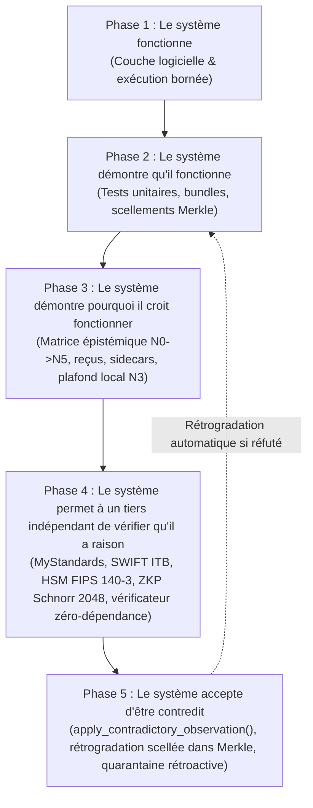

# Annonce Officielle, Manifeste Épistémique `Supela‑K3‑Ω` & Dossier de Remise pour Qualification `Niveau 4`

---

## PARTIE I — Annonce Officielle du Jalon `Supela‑2026‑Epsilon` (`v2026.10.19-epsilon-level4-prep`)

> [!IMPORTANT]
> **COMMUNIQUÉ D'ARCHITECTURE & DE GOUVERNANCE — RÉFÉRENTIEL INTERNE `SUPELA‑K3‑Ω`**
> **Objet :** Scellement cryptographique et publication de la branche de préparation `Niveau 4` (`supela-2026-epsilon-level4-prep` | Tag annoté signé GPG `v2026.10.19-epsilon-level4-prep`).
> **Conservation du Jalon Précédent :** Le jalon `Niveau 3 — Auditable` (`v2026.10.19-delta-level3`, commit `be3a4eb3cef8e0fecc7e6dac7161e2e2b79b6e59`) demeure strictement gelé et inaltéré comme ligne de base historique.

### 1. Synthèse de l'Étape Franchie
Avec la publication scellée **`Supela‑2026‑Epsilon`**, `Supela‑K3‑Ω` franchit la frontière technique qui sépare un système **auditable localement (`Niveau 3`)** d'une architecture **pré‑qualifiable par des tiers indépendants (`Pré‑Niveau 4`)**, tout en maintenant l'interdiction absolue d'auto‑attribution des `Niveaux 4 et 5` dans son propre code (`self_attribution_of_level_4_or_5: false`).

### 2. Les 5 Avancées Matérielles Livrées et Vérifiées (`16/16` Tests)
1. **Exécution Réelle du Binaire CNCF `opa.exe` (`v1.21.1`)** :
   * Le pont [`src/opa_binary_bridge.py`](file:///C:/Users/Group/.gemini/antigravity/scratch/supela-k3-omega/src/opa_binary_bridge.py) exécute directement le binaire officiel `opa.exe` sur [`policies/guardrails.rego`](file:///C:/Users/Group/.gemini/antigravity/scratch/supela-k3-omega/policies/guardrails.rego) (`PASS: 5/5`) et démontre une parité de décision de `100 %` avec le moteur [`SupelaK3OmegaEngine`](file:///C:/Users/Group/.gemini/antigravity/scratch/supela-k3-omega/src/supela_k3_engine.py) (`test_15`).
2. **Mode `CBPR_PLUS_STRICT` (*Detached Lineage Sidecar*) & Validation C `libxml2` XSD** :
   * Toute extension `<SplmtryData>` est bannie du message réseau [`02_wire_pacs_008_001_10_strict.xml`](file:///C:/Users/Group/.gemini/antigravity/scratch/supela-k3-omega/evidence/mystandards_submission_pack/02_wire_pacs_008_001_10_strict.xml) afin d'éliminer tout rejet sur le réseau SWIFT FINplus.
   * La lignée `SUP‑0` est déportée dans un Sidecar XML détaché ([`04_detached_supela_lineage_sidecar.xml`](file:///C:/Users/Group/.gemini/antigravity/scratch/supela-k3-omega/evidence/mystandards_submission_pack/04_detached_supela_lineage_sidecar.xml)) lié au flux bancaire par `<BoundUETR>` et `<BoundWirePackageSha256>`, l'ensemble étant validé par le moteur C `libxml2` (`lxml.etree.XMLSchema`) contre trois schémas `.xsd` formels (`test_14`).
3. **Preuve Algébrique à Divulgation Nulle de Connaissance `Schnorr NIZK 2048 bits` (IETF RFC 3526 Groupe 14)** :
   * Le module [`src/schnorr_zkp.py`](file:///C:/Users/Group/.gemini/antigravity/scratch/supela-k3-omega/src/schnorr_zkp.py) remplace les simples hachages par un véritable protocole $\Sigma$ non‑interactif (Fiat‑Shamir) dans le sous‑groupe d'ordre premier $q = (p-1)/2$ d'un premier sûr de 2048 bits ($g^s \equiv R \cdot Y^c \pmod p$), avec rejet prouvé des falsifications algébriques $s+1 \pmod q$ (`test_13`).
4. **Suppression des Clés en Dur & Signature Asymétrique Détachée GPG Ed25519 (`.asc`)** :
   * Aucune clé secrète par défaut n'existe plus dans [`src/worm_merkle.py`](file:///C:/Users/Group/.gemini/antigravity/scratch/supela-k3-omega/src/worm_merkle.py) (génération CSPRNG 256 bits éphémère exposant uniquement l'empreinte publique `key_fingerprint_sha256`).
   * Le bundle [`evidence/audit_evidence_bundle.json`](file:///C:/Users/Group/.gemini/antigravity/scratch/supela-k3-omega/evidence/audit_evidence_bundle.json) est accompagné de sa signature asymétrique détachée [`evidence/audit_evidence_bundle.json.asc`](file:///C:/Users/Group/.gemini/antigravity/scratch/supela-k3-omega/evidence/audit_evidence_bundle.json.asc), vérifiable hors‑ligne via `gpg --verify` et par le script tiers sans dépendance [`src/verify_third_party_standalone.py`](file:///C:/Users/Group/.gemini/antigravity/scratch/supela-k3-omega/src/verify_third_party_standalone.py).
5. **Mécanisme Exécutable de Révision et de Rétrogradation Épistémique (`Dimension 5`)** :
   * La méthode [`apply_contradictory_observation()`](file:///C:/Users/Group/.gemini/antigravity/scratch/supela-k3-omega/src/supela_k3_engine.py#L387-L435) rétrograde automatiquement tout état `LEVEL_3_AUDITABLE` vers `LEVEL_2_TESTED_QUARANTINE` dès réception d'une observation contradictoire (ex. `NACK` SWIFT ou absence de `TPM`), et scelle un bloc `K3_EPISTEMIC_DEMOTION` immuable dans la chaîne de Merkle (`test_16`).

### 3. Empreintes de Référence de la Publication `v2026.10.19-epsilon-level4-prep`
* **Commit Git Signé GPG Ed25519** : `b854de87750ad3bed8d977a1adcaf8efed1fcb31` (`verified: true`)
* **Tag Annoté Signé GPG Ed25519** : `v2026.10.19-epsilon-level4-prep` (`f1d3dc76bfa65db5171fbef8211cfdb7861225f0`, `verified: true`)
* **Bundle d'Évidence (`v2.epsilon`)** : `sha256:81cf467625747906c9cd9c0ff49e9218a3d80892da9b592a469708f2091bb796`
* **Signature GPG Détachée (`.asc`)** : `sha256:aacd9cc89fcae789dc6a85f2d948c794b87df0dd375e108ee001deb19b3a8d02`
* **Release GitHub Officielle** : `https://github.com/gadboisjean1000-arch/Supela-K3-Omega/releases/tag/v2026.10.19-epsilon-level4-prep`

---

## PARTIE II — Le Manifeste Épistémique `Supela‑K3‑Ω` (*Master Governance Document*)

### 1. Définition Canonique Officielle
> **Définition (`Master Governance Document — Supela‑K3‑Ω`) :**
> **`Supela‑K3‑Ω`** est une architecture de gouvernance épistémique et d'exécution déterministe dans laquelle chaque action, chaque artefact et chaque affirmation de conformité sont soumis à une obligation de preuve graduée, à une contre‑vérification contradictoire et à une règle de rétrogradation automatique.
> La singularité de `Supela‑K3‑Ω` ne réside pas dans l'emploi isolé d'un moteur de politiques, d'une signature cryptographique ou d'un journal immuable, mais dans **l'intégration explicite de l'exécution, de la preuve, de la réfutation et du statut de connaissance au sein d'une même chaîne opératoire, avec interdiction formelle de promouvoir une affirmation au‑delà du niveau réellement démontré**.

### 2. Les Trois Axiomes Fondateurs de la Discipline Cognitive `Supela‑K3‑Ω`

1. **Axiome de Lucidité Épistémique (Frontière du Savoir)** :
   > *« Nous savons certaines choses. Nous ignorons certaines choses. Nous savons lesquelles. »*
2. **Axiome de Légitimité d'Affirmation (Droit de Prétendre)** :
   > *« Les autres systèmes cherchent à prouver qu’ils fonctionnent. Supela cherche aussi à prouver qu’ils ont le droit de le prétendre. »*
3. **Axiome de Révisabilité par Contradiction (Refus du Dogme Technique)** :
   > *« Ce n’est pas un système qui cherche à avoir raison ; c’est un système qui cherche à rendre visible pourquoi il pense avoir raison, et quand il devrait cesser de le penser. »*

### 3. Les 5 Phases de la Trajectoire `Supela‑K3‑Ω`



### 4. Les 5 Dimensions Gouvernées & la Chaîne Opératoire à 9 Étapes

Là où l'informatique traditionnelle se contente de la séquence linéaire $\text{Action} \rightarrow \text{Journal} \rightarrow \text{Succès}$, `Supela‑K3‑Ω` impose que chaque transaction traverse **neuf étapes** couvrant **cinq dimensions gouvernées** :

$$\underbrace{\text{1. Proposition} \rightarrow \text{2. Politique} \rightarrow \text{3. Exécution bornée}}_{\text{Dimension I : L'Exécution}} \rightarrow \underbrace{\text{4. Artefact} \rightarrow \text{5. Preuve}}_{\text{Dimension II : La Preuve}} \rightarrow \underbrace{\text{6. Contre-vérification}}_{\text{Dimension IV : La Contradiction}} \rightarrow \underbrace{\text{7. Statut épistémique} \rightarrow \text{8. Publication vérifiable}}_{\text{Dimension III : La Qualification}} \rightarrow \underbrace{\text{9. Révision possible}}_{\text{Dimension V : La Révision}}$$

* **Aucun composant ne peut s'autocertifier** : le code local est structurellement plafonné au `LEVEL_3_AUDITABLE`.
* **Un test vert local n'est jamais travesti en conformité réglementaire** : un UUIDv4 valide porte le statut `CANDIDATE_UETR_UUIDV4` tant qu'il n'a pas franchi les portails SWIFT externes.
* **L'absence d'une preuve matérielle (TPM, HSM, WORM cloud) reste visible** et bloque toute promotion indue.

---

## PARTIE III — Dossier Opérationnel de Qualification `Niveau 4` (Bordereau de Remise aux Tiers)

Ce dossier regroupe les instructions exactes permettant à un évaluateur externe (équipe SWIFT, auditeur cryptographique, RSSI) de qualifier ou de réfuter le système sans dépendre des déclarations de l'auteur.

### 1. Bordereau des Pièces Remises à l'Évaluateur Tiers

| Réf. Pièce | Chemin dans le Dépôt / Release GitHub | Empreinte `SHA‑256` | Usage par l'Évaluateur Tiers |
| :---: | :--- | :--- | :--- |
| **P‑01** | [`evidence/audit_evidence_bundle.json`](file:///C:/Users/Group/.gemini/antigravity/scratch/supela-k3-omega/evidence/audit_evidence_bundle.json) | `sha256:81cf467625747906...091bb796` | Bundle complet d'évidence (`v2.epsilon`). |
| **P‑02** | [`evidence/audit_evidence_bundle.json.asc`](file:///C:/Users/Group/.gemini/antigravity/scratch/supela-k3-omega/evidence/audit_evidence_bundle.json.asc) | `sha256:aacd9cc89fcae789...a8d02` | Signature GPG Ed25519 détachée du bundle. |
| **P‑03** | [`01_bah_head_001_001_02_strict.xml`](file:///C:/Users/Group/.gemini/antigravity/scratch/supela-k3-omega/evidence/mystandards_submission_pack/01_bah_head_001_001_02_strict.xml) | `sha256:29007dc7545bc94f...d55d05` | À déposer sur **SWIFT MyStandards** & **SWIFT ITB**. |
| **P‑04** | [`02_wire_pacs_008_001_10_strict.xml`](file:///C:/Users/Group/.gemini/antigravity/scratch/supela-k3-omega/evidence/mystandards_submission_pack/02_wire_pacs_008_001_10_strict.xml) | `sha256:c21ed30e86ab8875...54bb8d` | À déposer sur **SWIFT MyStandards** & **SWIFT ITB** (zéro `<SplmtryData>`). |
| **P‑05** | [`03_wire_camt_053_001_10.xml`](file:///C:/Users/Group/.gemini/antigravity/scratch/supela-k3-omega/evidence/mystandards_submission_pack/03_wire_camt_053_001_10.xml) | `sha256:bbee22fb47e0dd86...d1aec` | À déposer sur **SWIFT MyStandards** (`camt.053.001.10`). |
| **P‑06** | [`04_detached_supela_lineage_sidecar.xml`](file:///C:/Users/Group/.gemini/antigravity/scratch/supela-k3-omega/evidence/mystandards_submission_pack/04_detached_supela_lineage_sidecar.xml) | `sha256:06164ea289a9b1cf...fdd06` | À remettre à la **Contrepartie Bilatérale** & **Auditeur WORM**. |
| **P‑07** | [`05_schnorr_2048_nizk_proof_vector.json`](file:///C:/Users/Group/.gemini/antigravity/scratch/supela-k3-omega/evidence/mystandards_submission_pack/05_schnorr_2048_nizk_proof_vector.json) | `sha256:ae0b1b561d797fbf...81677` | À remettre à l'**Auditeur Cryptographique ZKP**. |
| **P‑08** | [`src/verify_third_party_standalone.py`](file:///C:/Users/Group/.gemini/antigravity/scratch/supela-k3-omega/src/verify_third_party_standalone.py) | Script zéro‑dépendance Supela | À exécuter par l'auditeur pour contre‑vérifier **P‑01** à **P‑07**. |

### 2. Procédure de Contre‑Vérification Immédiate par l'Auditeur (En 3 Commandes)

```powershell
# 1. Vérification cryptographique GPG Ed25519 détachée via GnuPG officiel
gpg --verify evidence/audit_evidence_bundle.json.asc evidence/audit_evidence_bundle.json

# 2. Exécution du vérificateur tiers autonome (Zéro importation du moteur Supela)
python src/verify_third_party_standalone.py

# 3. Exécution contradictoire de la suite complète (16/16 tests incluant opa.exe, libxml2 et Schnorr 2048)
python tests/test_supela_k3_omega.py
```

### 3. Formulaire de Verdict Contradictoire de l'Évaluateur Tiers (`Promotion N4` vs `Rétrogradation N2`)

| Portail / Auditeur Tiers | Critère d'Homologation `Niveau 4` | Verdict Observé (`PASS` / `FAIL`) | Action Exécutée dans `Supela‑K3‑Ω` |
| :--- | :--- | :---: | :--- |
| **1. SWIFT MyStandards Readiness Portal** | `0 Fatal / 0 Error / 0 Warning` sur **P‑03** + **P‑04** (Collection CBPR+ SR en vigueur). | `[ ] PASS` / `[ ] FAIL` | Si `PASS` : Preuve `C1` validée.<br>Si `FAIL` : `apply_contradictory_observation()` $\rightarrow$ `LEVEL_2_TESTED_QUARANTINE`. |
| **2. SWIFT Integration Testbed (ITB)** | Réception `FINplus ACK` + `pacs.002.001.12` (`ACCP`/`ACSC`) avec `OrgnlUETR == c4c2ae76-d6e6-4af2-9503-07557f342cf9`. | `[ ] PASS` / `[ ] FAIL` | Si `PASS` : Promotion de `iso20022_cbpr_plus_compliance` au **`LEVEL_4_THIRD_PARTY_QUALIFIED`**. |
| **3. Auditeur Cryptographique ZKP** | Validation indépendante de $Y^q \equiv 1, R^q \equiv 1, g^s \equiv R \cdot Y^c \pmod p$ sur **P‑07** (RFC 3526 Groupe 14). | `[ ] PASS` / `[ ] FAIL` | Si `PASS` : Promotion de `zkp_validity` au **`LEVEL_4_THIRD_PARTY_QUALIFIED`**. |
| **4. Auditeur Sécurité HSM / Cloud WORM** | Attestation HSM FIPS 140‑3 (`Exportable=False`) + rejet `HTTP 403` sur `DeleteObject` par `Root` (S3 Object Lock `COMPLIANCE`). | `[ ] PASS` / `[ ] FAIL` | Si `PASS` : Promotion de `worm_ledger_immutability` au **`LEVEL_4_THIRD_PARTY_QUALIFIED`**. |
