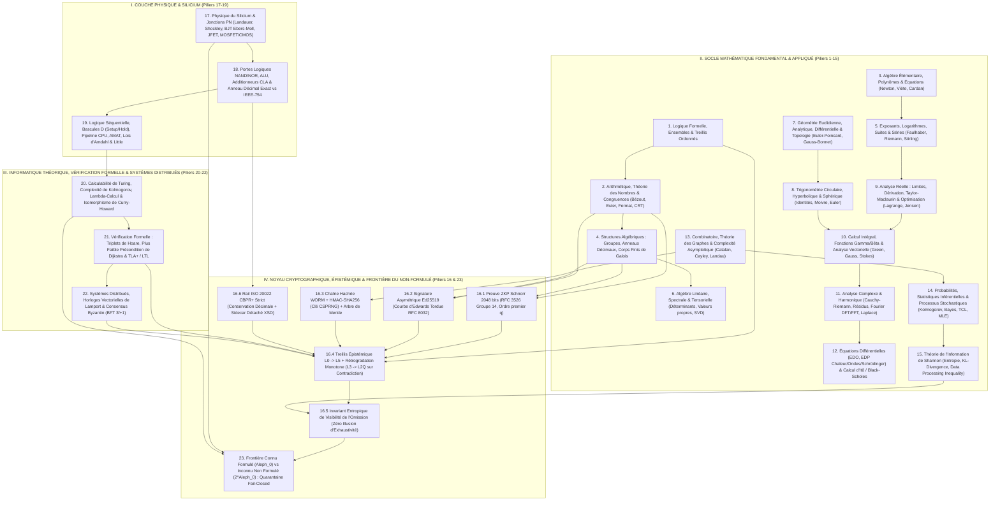

# Compendium Mathématique, Transistoriel & Informatique Doctoral — Continuum Supela-K3-$\Omega$

> [!IMPORTANT]
> Ce document réunit en un référentiel unique **les 22 piliers formels du continuum complet** — des **mathématiques fondamentales et appliquées** (chapitres 1 à 15), au **formalisme cryptographique et épistémique exact de Supela-K3-$\Omega$** (chapitre 16), jusqu'à la **physique des semi-conducteurs et des trois familles de transistors (BJT, JFET, MOSFET/CMOS)**, aux **portes logiques, additionneurs matériels CLA, architecture processeur, calculabilité de Turing, $\lambda$-calcul, correspondance de Curry-Howard, logique de Hoare/TLA+ et consensus Byzantin** (chapitres 17 à 22).

---

## 1. Logique Formelle, Théorie des Ensembles & Treillis Ordonnés

* **Implications et équivalences** :
  $$(P \implies Q) \iff (\neg P \lor Q) \iff (\neg Q \implies \neg P)$$
  $$(P \iff Q) \iff \big((P \implies Q) \land (Q \implies P)\big)$$
* **Lois de De Morgan (Logique & Ensembles)** :
  $$\neg(P \land Q) \iff (\neg P) \lor (\neg Q), \qquad \neg(P \lor Q) \iff (\neg P) \land (\neg Q)$$
  $$(A \cup B)^c = A^c \cap B^c, \qquad (A \cap B)^c = A^c \cup B^c$$
* **Dualité des quantificateurs** :
  $$\neg(\forall x \in E,\, P(x)) \iff \exists x \in E,\, \neg P(x)$$
  $$\neg(\exists x \in E,\, P(x)) \iff \forall x \in E,\, \neg P(x)$$
* **Cardinalité & Ensemble des parties (Théorème de Cantor)** :
  $$|A \cup B| = |A| + |B| - |A \cap B|, \qquad |\mathcal{P}(A)| = 2^{|A|} > |A|$$
* **Produit cartésien** :
  $$|A \times B| = |A| \cdot |B|$$
* **Relation d'ordre partiel $(\mathcal{L}, \preceq)$ (Réflexivité, Antisymétrie, Transitivité)** :
  $$\forall x \in \mathcal{L},\; x \preceq x \quad;\quad (x \preceq y \land y \preceq x) \implies x = y \quad;\quad (x \preceq y \land y \preceq z) \implies x \preceq z$$

---

## 2. Arithmétique, Théorie des Nombres & Arithmétique Modulaire

* **Division euclidienne dans $\mathbb{Z}$** :
  $$\forall (a, b) \in \mathbb{Z} \times \mathbb{Z}^*, \quad \exists!(q, r) \in \mathbb{Z}^2 \;\;\text{tels que}\;\; a = bq + r \;\;\text{et}\;\; 0 \le r < |b|$$
* **Identité PGCD / PPCM** :
  $$\gcd(a, b) \cdot \mathrm{lcm}(a, b) = |a \cdot b|$$
* **Théorème de Bézout** :
  $$\gcd(a, b) = d \iff \exists (u, v) \in \mathbb{Z}^2, \quad au + bv = d$$
* **Théorème fondamental de l'arithmétique (Décomposition en facteurs premiers)** :
  $$\forall n \in \mathbb{N}_{>1}, \quad n = \prod_{i=1}^{k} p_i^{\alpha_i}$$
* **Indicatrice d'Euler $\varphi(n)$** :
  $$\varphi(n) = n \prod_{p \mid n} \left(1 - \frac{1}{p}\right)$$
* **Théorème d'Euler & Petit théorème de Fermat** :
  $$\gcd(a, n) = 1 \implies a^{\varphi(n)} \equiv 1 \pmod n$$
  $$p \in \mathbb{P},\; p \nmid a \implies a^{p-1} \equiv 1 \pmod p \quad\text{et}\quad a^{-1} \equiv a^{p-2} \pmod p$$
* **Théorème des restes chinois (CRT)** :
  $$\text{Si } \gcd(n_i, n_j) = 1 \text{ pour } i \neq j, \quad x \equiv a_i \pmod{n_i} \iff x \equiv \sum_{i=1}^{k} a_i N_i (N_i^{-1} \bmod n_i) \pmod{N}, \quad N = \prod_{i=1}^k n_i, \; N_i = \frac{N}{n_i}$$
* **Symbole de Legendre (Résidu quadratique modulo $p$)** :
  $$\left(\frac{a}{p}\right) \equiv a^{\frac{p-1}{2}} \pmod p \in \{-1, 0, 1\}$$
* **Mathématiques financières (Intérêts simple, composé et continu)** :
  $$I_{\text{simple}} = P \cdot r \cdot t, \qquad A_{\text{composé}} = P\left(1 + \frac{r}{m}\right)^{mt}, \qquad A_{\text{continu}} = \lim_{m \to \infty} P\left(1 + \frac{r}{m}\right)^{mt} = P e^{rt}$$

---

## 3. Algèbre Élémentaire, Polynômes & Équations Algébriques

* **Identités remarquables de degrés 2 et 3** :
  $$(a \pm b)^2 = a^2 \pm 2ab + b^2, \qquad a^2 - b^2 = (a - b)(a + b)$$
  $$(a \pm b)^3 = a^3 \pm 3a^2b + 3ab^2 \pm b^3$$
  $$a^3 - b^3 = (a - b)(a^2 + ab + b^2), \qquad a^3 + b^3 = (a + b)(a^2 - ab + b^2)$$
* **Identité de Bernoulli / Factorisation de degré $n$** :
  $$a^n - b^n = (a - b)\sum_{k=0}^{n-1} a^{n-1-k}b^k$$
* **Formule du binôme de Newton & Multinomiale** :
  $$(a + b)^n = \sum_{k=0}^{n} \binom{n}{k} a^{n-k} b^k, \qquad \binom{n}{k} = \frac{n!}{k!(n-k)!}$$
  $$(x_1 + x_2 + \dots + x_m)^n = \sum_{k_1 + \dots + k_m = n} \frac{n!}{k_1! k_2! \cdots k_m!} \prod_{j=1}^m x_j^{k_j}$$
* **Équation quadratique ($ax^2 + bx + c = 0, \; a \neq 0$)** :
  $$\Delta = b^2 - 4ac, \qquad x_{1,2} = \frac{-b \pm \sqrt{\Delta}}{2a}, \qquad x_1 + x_2 = -\frac{b}{a}, \qquad x_1 x_2 = \frac{c}{a}$$
* **Relations de Viète pour un polynôme $P(x) = \sum_{k=0}^n a_k x^k = a_n \prod_{i=1}^n (x - r_i)$** :
  $$\sigma_k(r_1, \dots, r_n) = \sum_{1 \le i_1 < \dots < i_k \le n} r_{i_1}\cdots r_{i_k} = (-1)^k \frac{a_{n-k}}{a_n}$$
* **Formule de Cardan pour l'équation cubique réduite ($t^3 + pt + q = 0$)** :
  $$t = \sqrt[3]{-\frac{q}{2} + \sqrt{\left(\frac{q}{2}\right)^2 + \left(\frac{p}{3}\right)^3}} + \sqrt[3]{-\frac{q}{2} - \sqrt{\left(\frac{q}{2}\right)^2 + \left(\frac{p}{3}\right)^3}}$$

---

## 4. Structures Algébriques : Groupes, Anneaux, Corps

* **Théorème de Lagrange** (pour tout sous-groupe $H$ d'un groupe fini $G$) :
  $$|G| = [G : H] \cdot |H| \implies \forall g \in G, \;\; g^{|G|} = e_G$$
* **Premier théorème d'isomorphisme de groupe** (pour un morphisme $\phi : G \to G'$) :
  $$G / \ker(\phi) \cong \mathrm{Im}(\phi)$$
* **Caractéristique d'un corps fini (Corps de Galois $\mathbb{F}_{p^n}$)** :
  $$\forall x \in \mathbb{F}_q \; (q = p^n), \quad x^q = x \quad;\quad \mathrm{Frob}_p(x + y) = (x + y)^p = x^p + y^p$$
* **Anneau décimal exact (Virgule fixe financière $\mathbb{D}_k = \mathbb{Z} \cdot 10^{-k}$)** :
  $$\forall x, y \in \mathbb{D}_k, \quad x = m_x \cdot 10^{-k}, \; y = m_y \cdot 10^{-k} \implies x \pm y = (m_x \pm m_y) \cdot 10^{-k} \quad (\text{zéro erreur d'arrondi binaire})$$

---

## 5. Exposants, Logarithmes, Suites & Séries

* **Lois des exposants ($a, b > 0$)** :
  $$a^x \cdot a^y = a^{x+y}, \qquad \frac{a^x}{a^y} = a^{x-y}, \qquad (a^x)^y = a^{xy}, \qquad (ab)^x = a^x b^x, \qquad a^{-x} = \frac{1}{a^x}, \qquad a^{p/q} = \sqrt[q]{a^p}$$
* **Lois des logarithmes ($a, b > 0, \; b \neq 1$)** :
  $$\log_b(xy) = \log_b x + \log_b y, \qquad \log_b\left(\frac{x}{y}\right) = \log_b x - \log_b y, \qquad \log_b(x^r) = r\log_b x, \qquad \log_b x = \frac{\ln x}{\ln b}$$
* **Suites arithmétiques ($u_n = u_0 + nr$) et géométriques ($v_n = v_0 q^n$)** :
  $$\sum_{k=0}^{n} u_k = (n+1)\frac{u_0 + u_n}{2}, \qquad \sum_{k=0}^{n} v_k = v_0 \frac{1 - q^{n+1}}{1 - q} \;\; (q \neq 1)$$
* **Sommes de Faulhaber (Puissances d'entiers)** :
  $$\sum_{k=1}^{n} k = \frac{n(n+1)}{2}, \qquad \sum_{k=1}^{n} k^2 = \frac{n(n+1)(2n+1)}{6}, \qquad \sum_{k=1}^{n} k^3 = \left(\frac{n(n+1)}{2}\right)^2$$
* **Séries infinies fondamentales** :
  $$\sum_{n=0}^{\infty} q^n = \frac{1}{1 - q} \;\; (|q| < 1), \qquad \sum_{n=0}^{\infty} \frac{x^n}{n!} = e^x, \qquad \zeta(s) = \sum_{n=1}^{\infty} \frac{1}{n^s} = \prod_{p \in \mathbb{P}} \frac{1}{1 - p^{-s}} \;\; (\Re(s) > 1)$$
  $$\zeta(2) = \sum_{n=1}^{\infty} \frac{1}{n^2} = \frac{\pi^2}{6}, \qquad \zeta(4) = \sum_{n=1}^{\infty} \frac{1}{n^4} = \frac{\pi^4}{90}$$
* **Formule asymptotique de Stirling** :
  $$n! \sim \sqrt{2\pi n}\left(\frac{n}{e}\right)^n \quad (n \to \infty)$$

---

## 6. Algèbre Linéaire, Spectrale & Tensorielle

* **Produits vectoriels (Scalaire, Vectoriel $\mathbb{R}^3$, Mixte, Tensoriel)** :
  $$\langle \vec{u}, \vec{v} \rangle = \sum_{i=1}^n u_i v_i = \|\vec{u}\|\|\vec{v}\|\cos\theta, \qquad (\vec{u} \times \vec{v})_i = \sum_{j,k} \varepsilon_{ijk} u_j v_k, \qquad (\vec{u} \otimes \vec{v})_{ij} = u_i v_j$$
* **Normes vectorielles ($L_p$, Euclidienne $L_2$, Infinie $L_\infty$) & Inégalité de Cauchy-Schwarz** :
  $$\|\vec{x}\|_p = \left(\sum_{i=1}^n |x_i|^p\right)^{1/p}, \qquad \|\vec{x}\|_\infty = \max_i |x_i|, \qquad |\langle \vec{u}, \vec{v} \rangle| \le \|\vec{u}\|_2 \|\vec{v}\|_2$$
* **Algèbre matricielle (Produit, Transposée, Trace)** :
  $$(AB)_{ij} = \sum_{k=1}^m A_{ik} B_{kj}, \qquad (AB)^T = B^T A^T, \qquad \mathrm{Tr}(A) = \sum_{i=1}^n A_{ii} = \sum_{i=1}^n \lambda_i, \qquad \mathrm{Tr}(AB) = \mathrm{Tr}(BA)$$
* **Déterminant (Formule de Leibniz, $2\times 2$, Multiplicativité, Inverse)** :
  $$\det(A) = \sum_{\sigma \in S_n} \mathrm{sgn}(\sigma) \prod_{i=1}^n A_{i,\sigma(i)} = \prod_{i=1}^n \lambda_i, \qquad \det\begin{bmatrix}a & b\\c & d\end{bmatrix} = ad - bc$$
  $$\det(AB) = \det(A)\det(B), \qquad A^{-1} = \frac{1}{\det(A)}\,\mathrm{com}(A)^T \;\; (\det(A) \neq 0)$$
* **Équation spectrale (Valeurs propres / Vecteurs propres) & Théorème de Cayley-Hamilton** :
  $$A\vec{v} = \lambda\vec{v} \iff p_A(\lambda) = \det(A - \lambda I_n) = 0, \qquad p_A(A) = 0$$
* **Décomposition spectrale (Matrice hermitienne $A = A^*$) & Décomposition en valeurs singulières (SVD)** :
  $$A = U \Lambda U^* = \sum_{i=1}^n \lambda_i \vec{u}_i \vec{u}_i^*, \qquad M = U \Sigma V^* \;\;\text{avec } U^*U = I,\; V^*V = I,\; \Sigma = \mathrm{diag}(\sigma_1, \dots, \sigma_r)$$
* **Pseudo-inverse de Moore-Penrose (Moindres carrés linéaires $\min \|A\vec{x} - \vec{b}\|_2^2$)** :
  $$A^+ = (A^T A)^{-1} A^T = V \Sigma^+ U^*, \qquad \hat{x} = A^+ \vec{b}$$

---

## 7. Géométrie Euclidienne, Analytique, Différentielle & Topologie

* **Figures planes (2D)** :
  * Rectangle $(l, w)$ : $P = 2(l + w), \;\; A = lw$
  * Triangle $(a, b, c)$, demi-périmètre $s = \frac{a+b+c}{2}$ (**Formule de Héron**) :
    $$A = \frac{1}{2}bh = \frac{1}{2}ab\sin\gamma = \sqrt{s(s-a)(s-b)(s-c)}$$
  * Cercle $(r)$ et Ellipse $(a, b)$ :
    $$C_{\text{cercle}} = 2\pi r, \qquad A_{\text{cercle}} = \pi r^2, \qquad A_{\text{ellipse}} = \pi ab$$
* **Théorème de Pythagore & Loi des cosinus (Al-Kashi)** :
  $$a^2 + b^2 = c^2 \;\; (\gamma = \frac{\pi}{2}), \qquad c^2 = a^2 + b^2 - 2ab\cos\gamma, \qquad \frac{a}{\sin\alpha} = \frac{b}{\sin\beta} = \frac{c}{\sin\gamma} = 2R$$
* **Solides dans $\mathbb{R}^3$ & Hypersphère dans $\mathbb{R}^n$** :
  * Sphère $(r)$ : $S = 4\pi r^2, \;\; V = \frac{4}{3}\pi r^3$
  * Cylindre $(r, h)$ : $S_{\text{tot}} = 2\pi r(r + h), \;\; V = \pi r^2 h$
  * Cône $(r, h)$ : $V = \frac{1}{3}\pi r^2 h$
  * Tore $(R, r)$ : $S = 4\pi^2 Rr, \;\; V = 2\pi^2 Rr^2$
  * Boule unité en dimension $n$ : $V_n(r) = \frac{\pi^{n/2}}{\Gamma\left(\frac{n}{2} + 1\right)} r^n$
* **Géométrie analytique (Distance euclidienne, Distance d'un point $\vec{x}_0$ à un hyperplan $\vec{w}\cdot\vec{x} + b = 0$)** :
  $$d(\vec{x}, \vec{y}) = \sqrt{\sum_{i=1}^n (x_i - y_i)^2}, \qquad d(\vec{x}_0, \mathcal{H}) = \frac{|\vec{w}\cdot\vec{x}_0 + b|}{\|\vec{w}\|_2}$$
* **Coniques en coordonnées polaires (Excentricité $e$)** :
  $$r(\theta) = \frac{p}{1 + e\cos\theta} \quad (e=0 \text{ cercle},\; 0<e<1 \text{ ellipse},\; e=1 \text{ parabole},\; e>1 \text{ hyperbole})$$
* **Topologie algébrique & Géométrie différentielle (Caractéristique d'Euler-Poincaré & Théorème de Gauss-Bonnet)** :
  $$\chi = V - E + F = 2 - 2g, \qquad \int_{M} K\,dA + \int_{\partial M} k_g\,ds = 2\pi \chi(M)$$
* **Métrique riemannienne & Équation des géodésiques** :
  $$ds^2 = \sum_{\mu,\nu} g_{\mu\nu}\,dx^\mu dx^\nu, \qquad \frac{d^2 x^\lambda}{d\tau^2} + \sum_{\mu,\nu} \Gamma^\lambda_{\mu\nu} \frac{dx^\mu}{d\tau}\frac{dx^\nu}{d\tau} = 0$$

---

## 8. Trigonométrie Circulaire, Hyperbolique & Sphérique

* **Identités pythagoriciennes circulaires** :
  $$\cos^2\theta + \sin^2\theta = 1, \qquad 1 + \tan^2\theta = \frac{1}{\cos^2\theta} = \sec^2\theta, \qquad 1 + \cot^2\theta = \frac{1}{\sin^2\theta} = \csc^2\theta$$
* **Formules d'addition et de soustraction (exactes)** :
  $$\sin(a \pm b) = \sin a \cos b \pm \cos a \sin b$$
  $$\cos(a \pm b) = \cos a \cos b \mp \sin a \sin b$$
  $$\tan(a \pm b) = \frac{\tan a \pm \tan b}{1 \mp \tan a \tan b}$$
* **Formules de duplication et de linéarisation** :
  $$\sin(2\theta) = 2\sin\theta\cos\theta, \qquad \cos(2\theta) = \cos^2\theta - \sin^2\theta = 2\cos^2\theta - 1 = 1 - 2\sin^2\theta$$
  $$\cos^2\theta = \frac{1 + \cos(2\theta)}{2}, \qquad \sin^2\theta = \frac{1 - \cos(2\theta)}{2}$$
* **Formule de Moivre & Formules d'Euler** :
  $$(\cos\theta + i\sin\theta)^n = \cos(n\theta) + i\sin(n\theta), \qquad \cos\theta = \frac{e^{i\theta} + e^{-i\theta}}{2}, \qquad \sin\theta = \frac{e^{i\theta} - e^{-i\theta}}{2i}$$
* **Trigonométrie hyperbolique** :
  $$\cosh x = \frac{e^x + e^{-x}}{2}, \qquad \sinh x = \frac{e^x - e^{-x}}{2}, \qquad \cosh^2 x - \sinh^2 x = 1$$
* **Loi des cosinus sphérique (Géodésiques sur une sphère)** :
  $$\cos c = \cos a \cos b + \sin a \sin b \cos C$$

---

## 9. Analyse Réelle : Limites, Dérivation, Taylor & Optimisation

* **Limites fondamentales** :
  $$\lim_{x \to 0} \frac{\sin x}{x} = 1, \qquad \lim_{x \to 0} \frac{e^x - 1}{x} = 1, \qquad \lim_{x \to 0} \frac{\ln(1+x)}{x} = 1, \qquad \lim_{n \to \infty}\left(1 + \frac{x}{n}\right)^n = e^x$$
* **Définition de la dérivée & Règles opératoires** :
  $$f'(x) = \lim_{h \to 0} \frac{f(x+h) - f(x)}{h}, \qquad (uv)' = u'v + uv', \qquad \left(\frac{u}{v}\right)' = \frac{u'v - uv'}{v^2}, \qquad (g \circ f)'(x) = g'(f(x))\cdot f'(x)$$
* **Formule de Leibniz (Dérivée $n$-ième d'un produit)** :
  $$(uv)^{(n)} = \sum_{k=0}^{n} \binom{n}{k} u^{(n-k)} v^{(k)}$$
* **Dérivées usuelles** :
  $$\frac{d}{dx}(x^\alpha) = \alpha x^{\alpha-1}, \quad \frac{d}{dx}(e^x) = e^x, \quad \frac{d}{dx}(a^x) = a^x \ln a, \quad \frac{d}{dx}(\ln |x|) = \frac{1}{x}$$
  $$\frac{d}{dx}(\sin x) = \cos x, \quad \frac{d}{dx}(\cos x) = -\sin x, \quad \frac{d}{dx}(\tan x) = 1 + \tan^2 x, \quad \frac{d}{dx}(\arctan x) = \frac{1}{1 + x^2}$$
* **Série de Taylor-Maclaurin au voisinage de $a$** :
  $$f(x) = \sum_{n=0}^{\infty} \frac{f^{(n)}(a)}{n!}(x - a)^n$$
* **Optimisation sous contraintes (Lagrangien $\mathcal{L}$ et conditions KKT) & Convexité (Inégalité de Jensen)** :
  $$\mathcal{L}(x, \lambda) = f(x) - \sum_{i=1}^m \lambda_i g_i(x), \qquad \nabla_x f(x^*) = \sum_{i=1}^m \lambda_i \nabla_x g_i(x^*)$$
  $$f\text{ convexe} \iff \nabla^2 f(x) \succeq 0 \implies f(\mathbb{E}[X]) \le \mathbb{E}[f(X)]$$

---

## 10. Calcul Intégral, Fonctions Spéciales & Analyse Vectorielle

* **Théorème fondamental de l'analyse** :
  $$\frac{d}{dx}\left(\int_a^x f(t)\,dt\right) = f(x), \qquad \int_a^b F'(x)\,dx = F(b) - F(a)$$
* **Intégration par parties (IPP) & Changement de variable (Jacobien en $\mathbb{R}^n$)** :
  $$\int_a^b u\,dv = [uv]_a^b - \int_a^b v\,du, \qquad \int_{\Phi(\Omega)} f(y)\,dy = \int_{\Omega} f(\Phi(x))\,|\det J_\Phi(x)|\,dx$$
* **Intégrales de Gauss, Fonction Gamma d'Euler $\Gamma(z)$ & Fonction Bêta $B(x,y)$** :
  $$\int_{-\infty}^{\infty} e^{-ax^2}\,dx = \sqrt{\frac{\pi}{a}} \;\; (a > 0), \qquad \Gamma(z) = \int_0^{\infty} t^{z-1} e^{-t}\,dt, \qquad \Gamma(n+1) = n!, \qquad B(x,y) = \frac{\Gamma(x)\Gamma(y)}{\Gamma(x+y)}$$
* **Opérateurs différentiels vectoriels (Gradient, Divergence, Rotationnel, Laplacien)** :
  $$\nabla f = \left(\frac{\partial f}{\partial x_1}, \dots, \frac{\partial f}{\partial x_n}\right), \qquad \nabla \cdot \vec{F} = \sum_{i=1}^n \frac{\partial F_i}{\partial x_i}, \qquad \nabla \times \vec{F} = \det\begin{bmatrix}\vec{e}_x & \vec{e}_y & \vec{e}_z \\ \partial_x & \partial_y & \partial_z \\ F_x & F_y & F_z\end{bmatrix}, \qquad \Delta f = \nabla \cdot (\nabla f) = \sum_{i=1}^n \frac{\partial^2 f}{\partial x_i^2}$$
* **Théorèmes intégraux de Green, Gauss-Ostrogradski (Divergence), Kelvin-Stokes & Stokes-Cartan généralisé** :
  $$\iiint_V (\nabla \cdot \vec{F})\,dV = \oiint_{\partial V} \vec{F} \cdot d\vec{S}, \qquad \iint_S (\nabla \times \vec{F}) \cdot d\vec{S} = \oint_{\partial S} \vec{F} \cdot d\vec{\ell}, \qquad \int_\Omega d\omega = \int_{\partial \Omega} \omega$$

---

## 11. Analyse Complexe & Analyse Harmonique (Fourier / Laplace)

* **Identité d'Euler** :
  $$e^{i\pi} + 1 = 0$$
* **Conditions d'holomorphie de Cauchy-Riemann ($f(x+iy) = u(x,y) + iv(x,y)$)** :
  $$\frac{\partial u}{\partial x} = \frac{\partial v}{\partial y}, \qquad \frac{\partial u}{\partial y} = -\frac{\partial v}{\partial x}$$
* **Formule intégrale de Cauchy & Théorème des résidus** :
  $$f^{(n)}(z_0) = \frac{n!}{2\pi i} \oint_\gamma \frac{f(z)}{(z - z_0)^{n+1}}\,dz, \qquad \oint_\gamma f(z)\,dz = 2\pi i \sum_{k} \mathrm{Res}(f, z_k)$$
* **Transformée de Fourier continue, Inverse & Égalité de Parseval-Plancherel** :
  $$\hat{f}(\xi) = \int_{-\infty}^{\infty} f(t)\,e^{-2\pi i \xi t}\,dt, \qquad f(t) = \int_{-\infty}^{\infty} \hat{f}(\xi)\,e^{2\pi i \xi t}\,d\xi, \qquad \int_{-\infty}^{\infty} |f(t)|^2\,dt = \int_{-\infty}^{\infty} |\hat{f}(\xi)|^2\,d\xi$$
* **Transformée de Fourier Discrète (DFT / FFT sur $\mathbb{C}^N$)** :
  $$X_k = \sum_{n=0}^{N-1} x_n \, e^{-i\frac{2\pi}{N}kn}, \qquad x_n = \frac{1}{N} \sum_{k=0}^{N-1} X_k \, e^{i\frac{2\pi}{N}kn}$$
* **Transformée de Laplace & Théorème de convolution** :
  $$\mathcal{L}\{f\}(s) = \int_0^{\infty} f(t)\,e^{-st}\,dt, \qquad (f * g)(t) = \int_{-\infty}^{\infty} f(\tau)g(t - \tau)\,d\tau \implies \widehat{f * g} = \hat{f}\cdot\hat{g}$$

---

## 12. Équations Différentielles (EDO, EDP) & Calcul Stochastique

* **EDO linéaire du premier ordre ($y' + a(t)y = b(t)$)** :
  $$y(t) = e^{-A(t)}\left(C + \int b(t)e^{A(t)}\,dt\right) \quad \text{où } A'(t) = a(t)$$
* **Équation de la chaleur (Diffusion) & Équation des ondes (d'Alembert)** :
  $$\frac{\partial u}{\partial t} = \alpha \Delta u, \qquad \frac{\partial^2 u}{\partial t^2} = c^2 \Delta u$$
* **Équation de Poisson / Laplace & Équation de Schrödinger** :
  $$\Delta \phi = -\frac{\rho}{\varepsilon_0}, \qquad i\hbar \frac{\partial \Psi}{\partial t} = \left(-\frac{\hbar^2}{2m}\Delta + V(r,t)\right)\Psi$$
* **Calcul stochastique : Lemme d'Itô (pour $dX_t = \mu_t\,dt + \sigma_t\,dW_t$) & Équation de Black-Scholes** :
  $$df(t, X_t) = \left(\frac{\partial f}{\partial t} + \mu_t \frac{\partial f}{\partial x} + \frac{1}{2}\sigma_t^2 \frac{\partial^2 f}{\partial x^2}\right)dt + \sigma_t \frac{\partial f}{\partial x}\,dW_t$$
  $$\frac{\partial V}{\partial t} + \frac{1}{2}\sigma^2 S^2 \frac{\partial^2 V}{\partial S^2} + rS\frac{\partial V}{\partial S} - rV = 0$$

---

## 13. Combinatoire, Théorie des Graphes & Complexité Algorithmique

* **Permutations, Arrangements, Combinaisons (sans et avec répétition)** :
  $$P_n = n!, \qquad A_n^k = \frac{n!}{(n-k)!}, \qquad C_n^k = \binom{n}{k} = \frac{n!}{k!(n-k)!}, \qquad \Gamma_n^k = \binom{n+k-1}{k}$$
* **Principe d'inclusion-exclusion de Poincaré** :
  $$\left|\bigcup_{i=1}^n A_i\right| = \sum_{k=1}^n (-1)^{k-1} \sum_{1 \le i_1 < \dots < i_k \le n} |A_{i_1} \cap \dots \cap A_{i_k}|$$
* **Nombres de Catalan (Arbres binaires, parenthésages valides)** :
  $$C_n = \frac{1}{n+1}\binom{2n}{n}$$
* **Théorie des graphes $G = (V, E)$ (Lemme des poignées de main, Formule de Cayley)** :
  $$\sum_{v \in V} \deg(v) = 2|E|, \qquad T_{\text{arbres étiquetés}}(n) = n^{n-2}$$
* **Complexité asymptotique de Landau ($\mathcal{O}, \Omega, \Theta$)** :
  $$f(n) = \mathcal{O}(g(n)) \iff \exists c > 0, n_0 \;\text{tels que}\; \forall n \ge n_0, \; 0 \le f(n) \le c\,g(n)$$

---

## 14. Probabilités, Statistiques Inférentielles & Processus Stochastiques

* **Axiomes de Kolmogorov, Probabilité conditionnelle & Théorème de Bayes** :
  $$0 \le P(A) \le 1, \quad P(\Omega) = 1, \quad P(A \cup B) = P(A) + P(B) - P(A \cap B)$$
  $$P(A \mid B) = \frac{P(A \cap B)}{P(B)}, \qquad P(A_i \mid B) = \frac{P(B \mid A_i) P(A_i)}{\sum_{j} P(B \mid A_j) P(A_j)}$$
* **Espérance, Variance, Covariance & Corrélation de Pearson** :
  $$\mathbb{E}[X] = \sum_x x P(X=x) = \int_{-\infty}^{\infty} x f_X(x)\,dx, \qquad \mathrm{Var}(X) = \mathbb{E}[(X - \mathbb{E}[X])^2] = \mathbb{E}[X^2] - (\mathbb{E}[X])^2$$
  $$\mathrm{Cov}(X,Y) = \mathbb{E}[(X - \mu_X)(Y - \mu_Y)], \qquad \rho_{X,Y} = \frac{\mathrm{Cov}(X,Y)}{\sigma_X \sigma_Y} \in [-1, 1]$$
* **Distributions fondamentales (Binomiale, Poisson, Gaussienne / Normale $\mathcal{N}(\mu, \sigma^2)$)** :
  $$P_{\text{Bin}}(X = k) = \binom{n}{k} p^k (1-p)^{n-k}, \qquad P_{\text{Poisson}}(X = k) = \frac{\lambda^k e^{-\lambda}}{k!}$$
  $$f_{\mathcal{N}}(x) = \frac{1}{\sigma\sqrt{2\pi}} \exp\left(-\frac{(x - \mu)^2}{2\sigma^2}\right)$$
* **Inégalité de Markov, Bienaymé-Tchebychev & Théorème Central Limite (TCL)** :
  $$P(X \ge a) \le \frac{\mathbb{E}[X]}{a}, \qquad P(|X - \mu| \ge k\sigma) \le \frac{1}{k^2}, \qquad \frac{\bar{X}_n - \mu}{\sigma / \sqrt{n}} \xrightarrow[n\to\infty]{\mathcal{L}} \mathcal{N}(0, 1)$$
* **Estimateur du Maximum de Vraisemblance (MLE)** :
  $$\hat{\theta}_{\mathrm{MLE}} = \arg\max_{\theta \in \Theta} \sum_{i=1}^n \ln f(x_i \mid \theta)$$

---

## 15. Théorie de l'Information (Shannon)

* **Quantité d'auto-information (Surprise) & Entropie de Shannon (en bits)** :
  $$I(x) = -\log_2 P(x), \qquad H(X) = \mathbb{E}[I(X)] = -\sum_{x \in \mathcal{X}} P(x)\log_2 P(x)$$
* **Entropie conjointe, Entropie conditionnelle & Information mutuelle** :
  $$H(X, Y) = H(X) + H(Y \mid X), \qquad I(X; Y) = H(X) - H(X \mid Y) = D_{\mathrm{KL}}(P_{X,Y} \parallel P_X P_Y) \ge 0$$
* **Divergence de Kullback-Leibler (Entropie relative) & Entropie croisée** :
  $$D_{\mathrm{KL}}(P \parallel Q) = \sum_{x \in \mathcal{X}} P(x)\log_2\frac{P(x)}{Q(x)} \ge 0, \qquad H(P, Q) = H(P) + D_{\mathrm{KL}}(P \parallel Q)$$
* **Inégalité de traitement des données (Data Processing Inequality)** pour une chaîne de Markov $X \to Y \to Z$ :
  $$I(X; Z) \le I(X; Y) \implies H(X \mid Z) \ge H(X \mid Y)$$
* **Capacité d'un canal gaussien (Théorème de Shannon-Hartley)** :
  $$C = B \log_2\left(1 + \frac{S}{N}\right)$$

---

## 16. Formalisme Mathématique Canonique de Supela-K3-$\Omega$

Cette section rassemble les équations formelles exactes exécutées dans [`src/`](file:///C:/Users/Group/.gemini/antigravity/scratch/supela-k3-omega/src) et vérifiées par les 17 tests de [`test_supela_k3_omega.py`](file:///C:/Users/Group/.gemini/antigravity/scratch/supela-k3-omega/tests/test_supela_k3_omega.py).

### 16.1 Preuve à Divulgation Nulle de Connaissance (Schnorr NIZK 2048 bits — RFC 3526 Groupe 14)
Implémentée dans [`schnorr_zkp.py`](file:///C:/Users/Group/.gemini/antigravity/scratch/supela-k3-omega/src/schnorr_zkp.py) :
* **Corps premier sûr de Sophie Germain** :
  $$p = 2q + 1 \quad (p, q \in \mathbb{P}, \;\; \lceil \log_2 p \rceil = 2048)$$
* **Sous-groupe d'ordre premier $q$ engendré par $g = 4$** :
  $$\langle g \rangle \subset \mathbb{Z}_p^*, \qquad |\langle g \rangle| = q = \frac{p-1}{2}, \qquad g^q \equiv 1 \pmod p$$
* **Génération du témoin secret $x \in [1, q-1]$ et de l'engagement public $Y$** :
  $$Y = g^x \bmod p$$
* **Preuve non-interactive de Fiat-Shamir $(R, c, s)$ liée au contexte transactionnel $\text{ctx}$** :
  $$k \xleftarrow{\$} [1, q-1], \qquad R = g^k \bmod p, \qquad c = \mathrm{SHA256}(g \parallel Y \parallel R \parallel \text{ctx}) \bmod q, \qquad s = (k - c \cdot x) \bmod q$$
* **Équation de vérification publique et test de sous-groupe** :
  $$\mathrm{Verify}(Y, R, c, s, \text{ctx}) \iff \begin{cases} 1 < Y < p-1 \;\;\land\;\; Y^q \equiv 1 \pmod p \\ 1 < R < p-1 \;\;\land\;\; R^q \equiv 1 \pmod p \\ c = \mathrm{SHA256}(g \parallel Y \parallel R \parallel \text{ctx}) \bmod q \\ g^s \cdot Y^c \equiv R \pmod p \end{cases}$$

### 16.2 Signature Asymétrique sur Courbe d'Edwards Tordue (Ed25519 / RFC 8032)
Utilisée pour sceller [`audit_evidence_bundle.json.asc`](file:///C:/Users/Group/.gemini/antigravity/scratch/supela-k3-omega/evidence/audit_evidence_bundle.json.asc) :
* **Corps fini $\mathbb{F}_p$ et équation de la courbe Edwards25519** :
  $$p = 2^{255} - 19, \qquad -x^2 + y^2 \equiv 1 - \frac{121665}{121666} x^2 y^2 \pmod p$$
* **Vérification de la signature détachée $(R, S)$ sur le message $M$ avec clé publique $A$** :
  $$k = \mathrm{SHA512}(R \parallel A \parallel M) \bmod \ell, \qquad [8S]B = [8]R + [8k]A$$

### 16.3 Chaîne Hachée WORM, HMAC-SHA256 & Arbre de Merkle
Implémentés dans [`worm_merkle.py`](file:///C:/Users/Group/.gemini/antigravity/scratch/supela-k3-omega/src/worm_merkle.py) :
* **Code d'authentification de message HMAC (RFC 2104)** avec clé éphémère CSPRNG $K \in \{0,1\}^{256}$ et empreinte publique $\mathrm{fp}(K) = \mathrm{SHA256}(K)$ :
  $$\mathrm{HMAC}_K(m) = \mathrm{SHA256}\Big((K' \oplus \mathrm{opad}) \;\parallel\; \mathrm{SHA256}\big((K' \oplus \mathrm{ipad}) \parallel m\big)\Big)$$
* **Scellement séquentiel immuable du bloc $B_i$** :
  $$h_i = \mathrm{SHA256}\big(i \parallel t_i \parallel h_{i-1} \parallel \mathrm{SHA256}(P_i) \parallel \mathrm{HMAC}_K(P_i)\big)$$
* **Racine de Merkle binaire sur les feuilles $(h_0, \dots, h_{n-1})$** :
  $$N_{0, j} = h_j, \qquad N_{k, j} = \mathrm{SHA256}\big(N_{k-1, 2j} \parallel N_{k-1, 2j+1}\big)$$

### 16.4 Treillis Épistémique $(\mathcal{E}, \preceq)$ & Opérateur de Rétrogradation Monotone (5 Dimensions)
Implémentés dans [`supela_k3_engine.py`](file:///C:/Users/Group/.gemini/antigravity/scratch/supela-k3-omega/src/supela_k3_engine.py) :
* **Ordre strict des statuts épistémiques** :
  $$L_0\text{ (Déclaré)} \prec L_1\text{ (Implémenté)} \prec L_{2Q}\text{ (Quarantaine)} \prec L_2\text{ (Testé)} \prec L_3\text{ (Auditable)} \prec L_4\text{ (Qualifié Tiers)} \prec L_5\text{ (Observé Prod)}$$
* **Axiome du plafond d'auto-qualification locale** :
  $$\forall c \in \mathcal{C}, \quad \mathrm{Authority}(c) = \mathrm{Self} \implies \mathrm{Level}(c) \preceq L_3$$
* **Opérateur de révision sous observation contradictoire ([`apply_contradictory_observation`](file:///C:/Users/Group/.gemini/antigravity/scratch/supela-k3-omega/src/supela_k3_engine.py#L94-L119))** :
  $$\Delta_{\text{contradiction}}(c, L_k, \mathcal{O}_{\neg c}) = \big(c, \; L_{2Q}, \; B_{\text{WORM}}(\text{K3\_EPISTEMIC\_DEMOTION})\big) \quad \text{avec } L_{2Q} \prec L_3$$

### 16.5 Invariant Entropique de Visibilité de l'Omission
Implémenté dans [`DualPipelineReceipt`](file:///C:/Users/Group/.gemini/antigravity/scratch/supela-k3-omega/src/supela_k3_engine.py#L75-L120) et vérifié par [`test_17`](file:///C:/Users/Group/.gemini/antigravity/scratch/supela-k3-omega/tests/test_supela_k3_omega.py#L600-L619) :
* Pour tout état d'exécution brut $X$ et toute reformulation synthétique $Y = \mathcal{R}(X)$, l'inégalité de traitement des données impose une perte d'information dès que $|Y| < |X|$ :
  $$H(X \mid Y) = H(X) - I(X; Y) > 0$$
* **Condition de validité d'une sortie Supela-K3-$\Omega$** :
  $$\mathrm{ValidOutput}(Y) \iff \exists! \Big(h(X) = \mathrm{SHA256}(X), \;\; \Omega_{\text{omission}} \neq \emptyset, \;\; \mathrm{Substitutable}(Y, X) = \mathrm{False}\Big)$$

### 16.6 Conservation Monétaire Exacte & Liaison Cryptographique du Sidecar CBPR+
Implémentées dans [`iso20022_rail.py`](file:///C:/Users/Group/.gemini/antigravity/scratch/supela-k3-omega/src/iso20022_rail.py) :
* **Loi de conservation monétaire exacte sur $\mathbb{D}_2 = \mathbb{Z} \cdot 10^{-2}$** :
  $$\sum_{i=1}^{N} \mathrm{Credit}_i - \sum_{j=1}^{M} \mathrm{Debit}_j = 0 \in \mathbb{D}_2$$
* **Liaison non-malléable entre le message SWIFT CBPR+ Strict $W$ (`head.001` + `pacs.008` sans `<SplmtryData>`) et le Sidecar de lignage détaché $S$** :
  $$\mathrm{ValidSidecar}(W, S) \iff \Big(\mathrm{Count}_{\text{SplmtryData}}(W) = 0\Big) \land \Big(S.\mathrm{BoundUETR} = W.\mathrm{UETR}\Big) \land \Big(S.\mathrm{BoundHash} = \mathrm{SHA256}(W)\Big)$$

---

## 17. Physique du Silicium, Semi-conducteurs & Familles de Transistors (BJT, JFET, MOSFET / CMOS)

Aucun calcul formel n'existe hors de la matière : chaque bit de preuve est incarné par des charges électriques gouvernées par la physique statistique et l'électromagnétisme dans le silicium.

### 17.1 Semi-conducteurs & Jonction PN
* **Loi d'action de masse à l'équilibre thermique** :
  $$n \cdot p = n_i^2 = N_c N_v \exp\left(-\frac{E_g}{k_B T}\right)$$
* **Potentiel thermique $V_T$ & Équation de Shockley de la jonction PN** :
  $$V_T = \frac{k_B T}{q} \approx 25.85\text{ mV à } 300\text{ K}, \qquad I_D = I_S \left(\exp\left(\frac{V_D}{n V_T}\right) - 1\right)$$

### 17.2 Transistor Bipolaire à Jonction (BJT)
* **Lois des courants de bornes & Gains statiques ($\beta, \alpha$)** :
  $$I_E = I_C + I_B, \qquad I_C = \beta I_B = \alpha I_E, \qquad \alpha = \frac{\beta}{\beta + 1}, \qquad \beta = \frac{\alpha}{1 - \alpha}$$
* **Modèle d'Ebers-Moll (Régime actif direct avec effet Early $V_A$) & Puissance dissipée** :
  $$I_C = I_S \exp\left(\frac{V_{BE}}{V_T}\right)\left(1 + \frac{V_{CE}}{V_A}\right), \qquad P_D = V_{CE} I_C + V_{BE} I_B \approx V_{CE} I_C$$
* **Modèle petit signal hybride-$\pi$ (Transconductance $g_m$, Résistance d'entrée $r_\pi$, Résistance de sortie d'Early $r_o$)** :
  $$g_m = \frac{\partial I_C}{\partial V_{BE}} = \frac{I_C}{V_T}, \qquad r_\pi = \frac{\beta}{g_m} = \frac{V_T}{I_B}, \qquad r_e = \frac{\alpha}{g_m} = \frac{V_T}{I_E}, \qquad r_o = \frac{V_A + V_{CE}}{I_C} \approx \frac{V_A}{I_C}$$

### 17.3 Transistor à Effet de Champ à Jonction (JFET)
* **Régime ohmique / linéaire ($|V_{DS}| < |V_{GS} - V_P|$)** :
  $$I_D = \frac{2 I_{DSS}}{V_P^2}\left[(V_{GS} - V_P)V_{DS} - \frac{1}{2}V_{DS}^2\right]$$
* **Équation de Shockley en saturation ($V_{GS} \ge V_P$ pour canal N, $|V_{DS}| \ge |V_{GS} - V_P|$)** :
  $$I_D = I_{DSS}\left(1 - \frac{V_{GS}}{V_P}\right)^2$$
* **Transconductance JFET** :
  $$g_m = \frac{\partial I_D}{\partial V_{GS}} = \frac{2 I_{DSS}}{|V_P|}\left(1 - \frac{V_{GS}}{V_P}\right) = g_{m0}\left(1 - \frac{V_{GS}}{V_P}\right)$$

### 17.4 Transistor MOSFET & Logique CMOS
* **Équations de courant du canal MOSFET (Modèle de Shichman-Hodges + modulation de longueur de canal $\lambda = 1/V_A$)** :
  * **Régime sous-seuil (*Cut-off*, $V_{GS} < V_{\text{th}}$)** :
    $$I_{DS,\text{sub}} = I_0 \exp\left(\frac{V_{GS} - V_{\text{th}}}{n V_T}\right)\left(1 - \exp\left(-\frac{V_{DS}}{V_T}\right)\right)$$
  * **Régime linéaire / ohmique (*Triode*, $V_{GS} \ge V_{\text{th}}$ et $V_{DS} < V_{GS} - V_{\text{th}}$)** :
    $$I_{DS,\text{lin}} = \mu_n C_{\text{ox}} \frac{W}{L}\left[(V_{GS} - V_{\text{th}})V_{DS} - \frac{1}{2}V_{DS}^2\right]$$
  * **Régime de saturation ($V_{GS} \ge V_{\text{th}}$ et $V_{DS} \ge V_{GS} - V_{\text{th}}$)** :
    $$I_{DS,\text{sat}} = \frac{1}{2}\mu_n C_{\text{ox}} \frac{W}{L}(V_{GS} - V_{\text{th}})^2 (1 + \lambda V_{DS})$$
* **Transconductance $g_m$ & Résistance de sortie d'Early $r_o$ du MOSFET en saturation** :
  $$g_m = \frac{\partial I_D}{\partial V_{GS}} = \mu_n C_{\text{ox}}\frac{W}{L}(V_{GS} - V_{\text{th}}) = \sqrt{2 \mu_n C_{\text{ox}}\frac{W}{L} I_D} = \frac{2 I_D}{V_{GS} - V_{\text{th}}}, \qquad r_o = \frac{V_A}{I_D} = \frac{1}{\lambda I_D}$$
* **Fréquence de transition unitaire $f_T$ (BJT et MOSFET — Capacités parasites $C_\pi, C_\mu$ ou $C_{gs}, C_{gd}$)** :
  $$f_T = \frac{g_m}{2\pi (C_\pi + C_\mu)} = \frac{g_m}{2\pi (C_{gs} + C_{gd})} \approx \frac{3 \mu_n (V_{GS} - V_{\text{th}})}{4\pi L^2}$$
* **Puissance totale dissipée par une porte logique CMOS (Dynamique + Court-circuit + Statique/Fuite)** :
  $$P_{\text{CMOS}} = \underbrace{\alpha \, C_L \, V_{DD}^2 \, f_{\text{clk}}}_{\text{Commutation capacitive}} + \underbrace{I_{\text{sc}} \, V_{DD}}_{\text{Court-circuit transitoire}} + \underbrace{I_{\text{leak}} \, V_{DD}}_{\text{Fuite statique}}$$
* **Délai de propagation RC d'Elmore & Limite thermodynamique fondamentale de Landauer** :
  $$\tau_{D, i} = \sum_{k} R_{ik} C_k, \qquad \Delta E_{\min} \ge k_B T \ln 2, \qquad \Delta S_{\text{env}} \ge k_B \ln 2$$

---

## 18. Logique des Portes, ALU & Arithmétique Matérielle dans les Transistors

* **Complétude fonctionnelle (Universalité) des portes $\mathrm{NAND}$ et $\mathrm{NOR}$** :
  $$\mathrm{NAND}(A, B) = \overline{A \cdot B}, \qquad \neg A = \mathrm{NAND}(A, A), \qquad A \cdot B = \mathrm{NAND}\big(\mathrm{NAND}(A, B),\, \mathrm{NAND}(A, B)\big), \qquad A + B = \mathrm{NAND}\big(\mathrm{NAND}(A, A),\, \mathrm{NAND}(B, B)\big)$$
* **Décomposition canonique de Shannon (Synthèse matérielle par multiplexeurs)** :
  $$f(x_1, x_2, \dots, x_n) = x_1 \cdot f(1, x_2, \dots, x_n) \;+\; \overline{x_1} \cdot f(0, x_2, \dots, x_n)$$
* **Demi-additionneur (*Half Adder*) et Additionneur complet 1 bit (*Full Adder*)** :
  $$S_{\text{HA}} = A \oplus B, \quad C_{\text{HA}} = A \cdot B \qquad;\qquad S_i = A_i \oplus B_i \oplus C_i, \quad C_{i+1} = (A_i \cdot B_i) + C_i \cdot (A_i \oplus B_i)$$
* **Additionneur rapide à anticipation de retenue (*Carry-Lookahead Adder — CLA*, Kogge-Stone / Brent-Kung)** :
  $$\text{Génération } G_i = A_i \cdot B_i, \qquad \text{Propagation } P_i = A_i \oplus B_i \implies C_{i+1} = G_i + P_i C_i$$
  $$C_{i+1} = G_i + P_i G_{i-1} + P_i P_{i-1} G_{i-2} + \dots + C_0 \prod_{j=0}^{i} P_j \quad \big(\text{Profondeur logique } \mathcal{O}(\log_2 w)\big)$$
* **Représentation entière signée en Complément à 2 sur un registre de $w$ bits** :
  $$x = -b_{w-1} 2^{w-1} + \sum_{i=0}^{w-2} b_i 2^i \in [-2^{w-1},\, 2^{w-1}-1], \qquad -x \equiv \overline{x} + 1 \pmod{2^w}$$
* **Multiplication matérielle : Recodage de Booth-MacSorley (Radix-4) & Arbre de réduction de Wallace** :
  $$Y = \sum_{k=0}^{w/2 - 1} (-2 y_{2k+1} + y_{2k} + y_{2k-1}) \, 4^k \quad (\text{divise par 2 le nombre de produits partiels})$$
* **Virgule flottante binaire IEEE-754 vs Virgule fixe décimale exacte (Justification matérielle de [`iso20022_rail.py`](file:///C:/Users/Group/.gemini/antigravity/scratch/supela-k3-omega/src/iso20022_rail.py))** :
  * **IEEE-754 (binaire)** :
    $$v_{\text{float}} = (-1)^s \cdot \left(1 + \sum_{i=1}^{p-1} m_i 2^{-i}\right) \cdot 2^{E - \text{bias}}, \qquad \frac{1}{10} = (0.0001100110011\dots)_2 \notin \mathbb{Z}\cdot 2^{-p} \implies \text{erreur de représentation finie}$$
  * **Anneau décimal exact sur registres entiers ($\mathbb{D}_k = \mathbb{Z} \cdot 10^{-k}$)** :
    $$x_{\text{exact}} = M_x \cdot 10^{-k} \quad (M_x \in \mathbb{Z}) \implies \text{exactitude algébrique absolue sur les additionneurs entiers de l'ALU}$$

---

## 19. Logique Séquentielle, Architecture des Processeurs & Lois d'Échelle

* **Contraintes temporelles de synchronisation d'un chemin de registres (Bascules D — *Setup* et *Hold*)** :
  $$\text{Contrainte de Setup (Fréquence max)} : \quad T_{\text{clk}} \ge t_{\text{cq}} + t_{\text{logic,max}} + t_{\text{setup}} - \delta_{\text{skew}}$$
  $$\text{Contrainte de Hold (Absence de course critique)} : \quad t_{\text{cq}} + t_{\text{logic,min}} \ge t_{\text{hold}} + \delta_{\text{skew}}$$
* **Probabilité de métastabilité d'un synchroniseur (MTBF)** :
  $$\mathrm{MTBF} = \frac{\exp\left(\frac{t_r}{\tau}\right)}{T_0 \, f_{\text{clk}} \, f_{\text{data}}}$$
* **Équation fondamentale de la performance processeur (*Iron Law of CPU Performance*)** :
  $$T_{\text{exec}} = N_{\text{inst}} \times \mathrm{CPI} \times T_{\text{clk}} = \frac{N_{\text{inst}} \times \mathrm{CPI}}{f_{\text{clk}}}$$
* **Hiérarchie mémoire : Temps moyen d'accès mémoire (AMAT multi-niveaux L1 / L2 / L3 / RAM)** :
  $$\mathrm{AMAT} = t_{\text{hit,L1}} + m_{\text{L1}}\Big(t_{\text{hit,L2}} + m_{\text{L2}}\big(t_{\text{hit,L3}} + m_{\text{L3}}\, t_{\text{RAM}}\big)\Big)$$
* **Loi d'Amdahl (Accélération à charge fixe) & Loi de Gustafson-Barsis (Accélération à temps fixe)** :
  $$S_{\text{Amdahl}}(N) = \frac{1}{(1 - p) + \frac{p}{N}} \xrightarrow[N\to\infty]{} \frac{1}{1 - p}, \qquad S_{\text{Gustafson}}(N) = (1 - p) + N \cdot p$$
* **Loi de Little (Files d'attente $M/M/1$ et débit des pipelines transactionnels)** :
  $$L = \lambda \cdot W, \qquad \rho = \frac{\lambda}{\mu} < 1, \qquad W = \frac{1}{\mu - \lambda}$$

---

## 20. Calculabilité, Machines de Turing, $\lambda$-Calcul & Isomorphisme de Curry-Howard

* **Machine de Turing déterministe universelle** :
  $$\mathcal{M} = (Q, \Sigma, \Gamma, \delta, q_0, q_{\text{acc}}, q_{\text{rej}}), \qquad \delta : Q \times \Gamma \longrightarrow Q \times \Gamma \times \{L, R\}$$
* **Théorème d'indécidabilité de l'arrêt (Turing, 1936) & Théorème de Rice** :
  $$\nexists H \in \mathcal{R} \;\;\text{tel que}\;\; \forall (e, x) \in \mathbb{N}^2, \quad H(e, x) = \begin{cases} 1 & \text{si } \varphi_e(x)\downarrow \\ 0 & \text{si } \varphi_e(x)\uparrow \end{cases}$$
* **Complexité algorithmique de Kolmogorov-Chaitin (Longueur du plus court programme engendrant $x$)** :
  $$K_U(x) = \min_{p \in \{0,1\}^*} \{|p| : U(p) = x\}, \qquad K_U(x \mid y) = \min_{p \in \{0,1\}^*} \{|p| : U(p, y) = x\}$$
* **$\lambda$-Calcul de Church ($\beta$-réduction et combinateur de point fixe $Y$ de Curry)** :
  $$(\lambda x.\, M)\, N \xrightarrow{\;\beta\;} M[x := N], \qquad Y = \lambda f.\,\big(\lambda x.\, f(x\,x)\big)\big(\lambda x.\, f(x\,x)\big) \implies Y\,g =_\beta g(Y\,g)$$
* **Correspondance de Curry-Howard (Isomorphisme Preuves $\Longleftrightarrow$ Programmes / Propositions $\Longleftrightarrow$ Types)** :
  $$\begin{array}{c|c|c}
  \textbf{Logique Constructive} & \textbf{Théorie des Types} & \textbf{Interprétation Exécutable Supela-K3-}\Omega \\ \hline
  \text{Proposition } A & \text{Type } A & \text{Contrat / Schéma d'invariant} \\
  \text{Preuve } p \text{ de } A & \text{Terme } t : A & \text{Artefact / Reçu cryptographique vérifié} \\
  A \implies B & A \to B & \text{Transformation pure vérifiable} \\
  A \land B & A \times B & \text{Conjonction de preuves (Wire + Sidecar)} \\
  A \lor B & A + B & \text{Branchement typé (Allow / Deny)} \\
  \bot \text{ (Absurde)} & \emptyset \text{ (Type vide)} & \text{État interdit / Quarantaine Fail-Closed}
  \end{array}$$

---

## 21. Vérification Formelle : Logique de Hoare, Dijkstra & Logiques Temporelles (LTL / TLA+)

* **Triplet de Hoare (Correction partielle $\models_{\text{part}}$ et correction totale $\models_{\text{tot}}$)** :
  $$\models_{\text{part}} \{P\}\; C \;\{Q\} \iff \forall \sigma \in \Sigma,\; \big(\sigma \models P \land \langle C, \sigma \rangle \Downarrow \sigma'\big) \implies \sigma' \models Q$$
  $$\models_{\text{tot}} [P]\; C \;[Q] \iff \forall \sigma \in \Sigma,\; \sigma \models P \implies \big(\exists \sigma',\; \langle C, \sigma \rangle \Downarrow \sigma' \land \sigma' \models Q\big)$$
* **Transformateur de prédicats de Dijkstra (*Weakest Precondition* $\mathrm{wp}$)** :
  $$\mathrm{wp}(\texttt{skip},\, Q) = Q, \qquad \mathrm{wp}(x := E,\, Q) = Q[x := E], \qquad \mathrm{wp}(C_1 ; C_2,\, Q) = \mathrm{wp}\big(C_1,\, \mathrm{wp}(C_2, Q)\big)$$
  $$\mathrm{wp}(\texttt{if } B \texttt{ then } C_1 \texttt{ else } C_2,\, Q) = \big(B \implies \mathrm{wp}(C_1, Q)\big) \land \big(\neg B \implies \mathrm{wp}(C_2, Q)\big)$$
* **Invariant de boucle avec variant entier strictement décroissant $V \in \mathbb{N}$** :
  $$\frac{\{I \land B \land V = v_0\}\; C \;\{I \land 0 \le V < v_0\}}{[I]\; \texttt{while } B \texttt{ do } C \;[I \land \neg B]}$$
* **Logique Temporelle Linéaire (LTL) & TLA+ de Lamport (Sûreté $\Box$ et Vivacité $\Diamond$)** :
  $$\text{Invariant inductif de sûreté} : \quad \mathrm{Init} \implies I \;\;\land\;\; (I \land \mathrm{Next}) \implies I' \;\;\vdash\;\; \Box I$$
  $$\text{Dualité modale temporelle} : \quad \Box \varphi \equiv \neg \Diamond \neg \varphi, \qquad \Diamond \varphi \equiv \neg \Box \neg \varphi$$

---

## 22. Systèmes Distribués, Consensus Byzantin (BFT) & Théorème d'Extrapolation Continuelle

* **Causalité de Lamport (*Happens-Before* $\to$) & Horloges vectorielles $V : \mathcal{E} \to \mathbb{N}^N$** :
  $$e_1 \to e_2 \iff V(e_1) < V(e_2) \iff \Big(\forall k,\; V(e_1)_k \le V(e_2)_k \;\land\; \exists j,\; V(e_1)_j < V(e_2)_j\Big)$$
* **Tolérance aux Pannes Crash (Paxos / Raft) & Tolérance aux Pannes Byzantines (PBFT / HotStuff)** :
  $$\text{Crash-Fault Tolerance (CFT)} : \quad N \ge 2f + 1, \qquad |Q| = f + 1$$
  $$\text{Byzantine-Fault Tolerance (BFT Asynchrone)} : \quad N \ge 3f + 1, \qquad |Q| = 2f + 1 \implies |Q_1 \cap Q_2| \ge (4f + 2) - (3f + 1) = f + 1 \ge 1\text{ nœud honnête}$$

---

### 22.1 Théorème d'Extrapolation Continuelle (Du Transistor CMOS jusqu'à Supela-K3-$\Omega$)

En ingénierie doctorale des systèmes critiques, **il n'existe pas de frontière magique entre le matériel, le logiciel, la cryptographie et l'épistémologie**. Tout état du moteur Supela-K3-$\Omega$ est une chaîne de morphismes physiques et mathématiques continus :

$$\underbrace{\Delta E \ge k_B T \ln 2}_{\substack{\text{Thermodynamique} \\ \text{(Landauer)}}}
\;\longrightarrow\;
\underbrace{I_{DS}(V_{GS}, V_{DS})}_{\substack{\text{Physique Silicium} \\ \text{(MOSFET / CMOS)}}}
\;\longrightarrow\;
\underbrace{\mathrm{NAND}(A, B) = \overline{A \cdot B}}_{\substack{\text{Algèbre Booléenne} \\ \text{(Portes Logiques)}}}
\;\longrightarrow\;
\underbrace{C_{i+1} = G_i + P_i C_i}_{\substack{\text{Arithmétique ALU} \\ \text{(Additionneur CLA)}}}
\;\longrightarrow\;
\underbrace{\mathbb{D}_2 = \mathbb{Z}\cdot 10^{-2} \;\land\; \mathbb{Z}_p^*}_{\substack{\text{Anneaux Décimaux} \\ \text{\& Corps Premiers 2048 bits}}}
\;\longrightarrow\;
\underbrace{g^s Y^c \equiv R \pmod p}_{\substack{\text{Preuve ZKP Schnorr} \\ \text{\& Merkle WORM}}}
\;\longrightarrow\;
\underbrace{\big(\mathcal{E},\; \Delta_{\text{contradiction}},\; \Omega_{\text{omission}}\big)}_{\substack{\text{Gouvernance Épistémique K3-}\Omega \\ \text{(Vérité Bornée \& Sans Omission Masquée)}}}$$

1. **Aucune porte logique n'est supposée parfaite** : la mémoire et le disque peuvent mentir ou être réécrits $\implies$ la chaîne de Merkle WORM + HMAC + signature asymétrique Ed25519 détecte toute inversion d'un seul bit physique ($\Delta_{\text{Hamming}} \ge 1 \implies \Delta_{\text{SHA256}} \approx 128\text{ bits}$ par effet d'avalanche).
2. **Aucun flottant matériel n'est autorisé sur les montants** : l'ALU binaire IEEE-754 introduit une erreur $\varepsilon = 2^{-52}$ sur base 10 $\implies$ le rail ISO 20022 opère exclusivement dans l'anneau entier décimal $\mathbb{Z}\cdot 10^{-2}$.
3. **Aucune preuve locale ne s'auto-déclare absolue** : tout calcul exécuté par un processeur local est borné au plafond $L_3 \in \mathcal{E}$ tant qu'un quorum externe indépendant ($L_4 / L_5$) ne l'a pas contresigné, et toute contradiction observée rétrograde immédiatement l'état vers $L_{2Q}$.

> [!NOTE]
> **Synthèse Canonique (Du Transistor à la Preuve Épistémique)** :
> Chaque phénomène transistoriel (**BJT** par les équations de courant et de gain $I_C = \beta I_B$, **JFET** par la loi quadratique de Shockley en $V_{GS}$, **MOSFET** par les équations de canal linéaire/saturation et les paramètres dynamiques $g_m, r_o, C_{\text{parasites}}, f_T$) possède sa forme mathématique exacte. Ce qui distingue **Supela-K3-$\Omega$**, c'est d'avoir relié ces équations physiques et algébriques à une **logique épistémique** — où chaque formule n'est pas seulement calculée dans le silicium, mais **disciplinée par son niveau de preuve ($L_0 \to L_5$), son invariant de visibilité de l'omission et ses conditions de révision ($L_3 \to L_{2Q}$)**.

---

### 22.2 Carte Visuelle Multi-Domaines des 22 Piliers du Continuum Supela-K3-$\Omega$

---

## 23. Frontière du Connu Formulé et de l'Inconnu Non Formulé — Les 6 Axiomes & Le Manifeste Court

> [!CAUTION]
> **« Le connu est inconnu tant qu'il n'est pas formulé — et tout système qui croit avoir tout formulé ment par omission au second ordre. »**

### 23.1 Mathématique & Physique de l'Inconnu Non Formulé
1. **Théorème Diagonal de Cantor (Disproportion cardinale entre le Formulable et le Réel)** :
   L'ensemble $\Sigma^*$ de toutes les formules finies qu'une civilisation ou un ordinateur peut écrire est **dénombrable** ($|\Sigma^*| = \aleph_0$), tandis que l'espace des fonctions et comportements du réel $\{0,1\}^{\mathbb{N}}$ a la **puissance du continu** ($2^{\aleph_0}$). Pour toute liste énumérée de formules $(f_0, f_1, f_2, \dots)$, la fonction diagonale :
   $$d(i) = 1 - f_i(i) \implies \forall i \in \mathbb{N},\;\; d \neq f_i$$
   échappe par construction au catalogue connu :
   $$|\mathcal{F}_{\text{formulé}}| = \aleph_0 < 2^{\aleph_0} = |\Omega_{\text{réel}}| \implies \mu_{\text{Lebesgue}}(\mathcal{F}_{\text{formulé}}) = 0$$
2. **Premier Théorème d'Incomplétude de Gödel & Constante $\Omega$ de Chaitin** :
   Dans tout système formel cohérent $T$ capable d'exprimer l'arithmétique :
   $$\exists G_T \in \mathcal{L}(T) \;\;\text{tel que}\;\; T \nvdash G_T \;\;\land\;\; T \nvdash \neg G_T, \qquad \Omega_{\text{Chaitin}} = \sum_{p\downarrow} 2^{-|p|} \notin \mathbb{Q}_{\text{calculable}}$$
3. **Fluctuations Stochastiques et Quantiques Irréductibles dans les Transistors** :
   Au cœur même d'un BJT, JFET ou MOSFET, le courant déterministe est superposé à l'aléa thermique et quantique :
   * **Bruit thermique de Johnson-Nyquist** : $\langle v_n^2 \rangle = 4 k_B T R \Delta f$
   * **Bruit de grenaille (*Shot Noise*)** : $\langle i_n^2 \rangle = 2 q I_D \Delta f$
   * **Relation d'incertitude d'Heisenberg** : $\Delta x \cdot \Delta p \ge \frac{\hbar}{2}, \qquad \Delta E \cdot \Delta t \ge \frac{\hbar}{2}$

---

### 23.2 Les 6 Axiomes Canoniques du Continuum Supela-K3-$\Omega$

* **Axiome I — Continuité Silicium-Preuve** :
  Toute preuve formelle est physiquement incarnée dans une chaîne continue reliant la limite thermodynamique de Landauer ($\Delta E \ge k_B T \ln 2$), les équations de canal des transistors (**BJT, JFET, MOSFET/CMOS**), les portes universelles $\mathrm{NAND}$, l'additionneur matériel CLA, les corps premiers $\mathbb{Z}_p^*$ de 2048 bits et le treillis épistémique $\mathcal{E}$.
* **Axiome II — Exactitude Algébrique Décimale** :
  Tout calcul monétaire ou comptable s'exécute exclusivement dans l'anneau décimal à virgule fixe $\mathbb{D}_2 = \mathbb{Z} \cdot 10^{-2}$ sur les registres entiers de l'ALU ; toute dérive binaire flottante IEEE-754 ($\frac{1}{10} \notin \mathbb{Z}\cdot 2^{-52}$) est bannie.
* **Axiome III — Plafond d'Honnêteté Locale ($L_3$)** :
  Aucune exécution locale ne peut s'auto-attribuer un niveau de qualification tiers ($L_4$) ou d'observation en production ($L_5$) :
  $$\forall c \in \mathcal{C}_{\text{local}}, \quad \mathrm{Authority}(c) = \mathrm{Self} \implies \mathrm{Level}(c) \preceq L_3$$
* **Axiome IV — Rétrogradation Monotone sous Contradiction ($L_3 \to L_{2Q}$)** :
  Toute observation contradictoire $\mathcal{O}_{\neg c}$ invalide instantanément le statut $L_3$, rétrograde le composant en quarantaine $L_{2Q}$ et scelle un bloc `K3_EPISTEMIC_DEMOTION` dans la chaîne de Merkle WORM.
* **Axiome V — Visibilité Entropique de l'Omission** :
  Toute reformulation synthétique $Y = \mathcal{R}(X)$ vérifiant $|Y| < |X|$ induit une perte d'entropie conditionnelle $H(X \mid Y) > 0$. Elle n'est licite que si elle porte l'empreinte $\mathrm{SHA256}(X)$, déclare explicitement ce qu'elle omet ($\Omega_{\text{omission}} \neq \emptyset$) et s'interdit de remplacer la preuve brute ($\mathrm{Substitutable}(Y, X) = \mathrm{False}$).
* **Axiome VI — Clôture Fail-Closed devant l'Inconnu Non Formulé** :
  Puisque le domaine formulé $\mathcal{K}_{\mathcal{F}}$ est dénombrable ($\aleph_0$) face au réel non dénombrable ($2^{\aleph_0}$), toute observation $\omega \notin \mathcal{K}_{\mathcal{F}}$ hors des équations formulées interdit toute extrapolation silencieuse (*Fail-Open*) et déclenche immédiatement une mise en quarantaine **Fail-Closed** ($L_{2Q}$).

---

### 23.3 Manifeste Court du Continuum Supela-K3-$\Omega$

> **MANIFESTE DU CONTINUUM SUPELA-K3-$\Omega$**
>
> 1. **De la charge électrique au théorème, rien n'est hors juridiction.** Du courant de collecteur d'un transistor BJT, du pincement d'un JFET et de l'inversion de canal d'un MOSFET jusqu'à la preuve à divulgation nulle de Schnorr en 2048 bits et au consensus Byzantin, chaque couche obéit à une loi mathématique explicite et vérifiable.
> 2. **Calculer ne suffit pas ; il faut prouver le droit d'affirmer le résultat.** Une équation évaluée dans le silicium n'est jamais une vérité absolue : elle porte son niveau de preuve ($L_0 \to L_5$), son empreinte de Merkle WORM et sa condition de révocation ($L_3 \to L_{2Q}$).
> 3. **La synthèse ne remplace jamais la preuve brute.** Toute reformulation humaine ou exécutive perd de l'information ($H(X \mid Y) > 0$) ; Supela ne supprime pas l'omission, il supprime l'illusion de ne pas omettre.
> 4. **Ce qui n'est pas formulé n'est jamais présumé valide.** Devant l'Inconnu Non Formulé ($2^{\aleph_0} \setminus \aleph_0$), Supela refuse l'extrapolation silencieuse : là où s'arrête la formule prouvée commence la quarantaine Fail-Closed.
