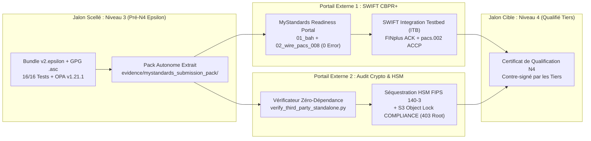
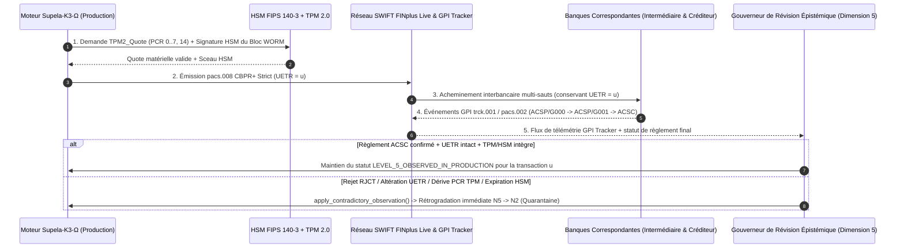

# Dossier Exécutif Comité d'Architecture : Feuille de Route `N4`, Matrice Épistémique Imprimable, Audit ZKP/HSM & Montée vers `N5` (`Supela‑K3‑Ω`)

> [!IMPORTANT]
> **Thèse Directrice du Référentiel `Supela‑K3‑Ω` :**
> *« La singularité de Supela‑K3‑Ω réside dans l’intégration explicite de l’exécution, de la preuve, de la réfutation et du statut de connaissance au sein d’une même chaîne de gouvernance, avec interdiction de promouvoir une affirmation au‑delà du niveau réellement démontré. »*
>
> **Axiome Opposable :**
> *« Les autres systèmes cherchent à prouver qu’ils fonctionnent. Supela cherche aussi à prouver qu’ils ont le droit de le prétendre. »*

---

## 1. Matrice de Gouvernance Épistémique Imprimable (`Niveaux 0 → 5`)

Cette matrice constitue la **grille d'opposabilité officielle** de `Supela‑K3‑Ω` pour les comités d'architecture, de risque et de conformité :

| Niveau Épistémique | Définition Normative Interne `Supela‑K3‑Ω` | Droit d'Auto‑Attribution par le Runtime Local | Statut Actuel (`Epsilon`) | Mécanisme de Révision / Rétrogradation (`Dimension 5`) |
| :--- | :--- | :---: | :---: | :--- |
| **`LEVEL_0_DECLARED`** | Assertion architecturale décrite dans la documentation sans implémentation logicielle. | Oui | Dépassé | Rétrogradation immédiate vers `N0` si le fichier source est absent du manifeste `SHA‑256`. |
| **`LEVEL_1_IMPLEMENTED`** | Code source présent dans le dépôt mais non exercé par des tests contradictoires. | Oui | Dépassé | Rétrogradation vers `N1` si un test unitaire ou négatif est désactivé ou échoue. |
| **`LEVEL_2_TESTED_QUARANTINE`** | Chemins nominaux et contradictoires exercés localement (ou état de repli après réfutation). | Oui | **Cible de repli sur contradiction** | État attribué automatiquement par [`apply_contradictory_observation()`](file:///C:/Users/Group/.gemini/antigravity/scratch/supela-k3-omega/src/supela_k3_engine.py#L387-L435) en cas de rejet externe (`NACK`, `TPM` absent). |
| **`LEVEL_3_AUDITABLE`** | **Plafond local maximal** : Artefacts, 16 tests contradictoires, preuves Schnorr 2048 bits, validation C `libxml2` XSD et binaire `opa.exe` scellés avec signature GPG Ed25519 détachée (`.asc`). | **Oui (Plafond Local Strict)** | **ATTEINT & SCELLÉ (`v2026.10.19-epsilon-level4-prep`)** | Toute divergence détectée par [`verify_third_party_standalone.py`](file:///C:/Users/Group/.gemini/antigravity/scratch/supela-k3-omega/src/verify_third_party_standalone.py) invalide le sceau `N3`. |
| **`LEVEL_4_THIRD_PARTY_QUALIFIED`** | Qualification formelle délivrée et signée par une autorité ou un banc d'essai externe indépendant (SWIFT MyStandards/ITB, HSM FIPS 140‑3, Auditeur ZKP). | **INTERDIT (`False`)** | **Prêt pour Dépôt Externe (`mystandards_submission_pack`)** | Si un rapport MyStandards/ITB ou HSM ultérieur échoue sur une nouvelle release, rétrogradation immédiate `N4 → N2`. |
| **`LEVEL_5_OBSERVED_IN_PRODUCTION`** | Exploitation réelle observée de bout en bout sur une infrastructure interbancaire et matérielle en production (persistance UETR sur SWIFT GPI Tracker, TPM/HSM actif). | **INTERDIT (`False`)** | Planifié (Section 4) | Surveillance télémétrique continue : toute anomalie en production (`NACK`, dérive PCR TPM, bail KMS expiré) rétrograde en temps réel `N5 → N2`. |

---

## 2. Fiche Officielle : « Supela `N4` Qualification Roadmap » (Format Comité)



### Tableau Récapitulatif des Livrables de Qualification `N4`

| Lot de Qualification | Artefact d'Entrée Fourni par `Supela-2026-Epsilon` | Vérificateur / Autorité Externe | Preuve Opposable Attendue en Sortie (`Niveau 4`) |
| :--- | :--- | :--- | :--- |
| **Lot Q1 — Syntaxe & Règles CBPR+** | [`01_bah_head_001_001_02_strict.xml`](file:///C:/Users/Group/.gemini/antigravity/scratch/supela-k3-omega/evidence/mystandards_submission_pack/01_bah_head_001_001_02_strict.xml) + [`02_wire_pacs_008_001_10_strict.xml`](file:///C:/Users/Group/.gemini/antigravity/scratch/supela-k3-omega/evidence/mystandards_submission_pack/02_wire_pacs_008_001_10_strict.xml) | **SWIFT MyStandards Readiness Portal** | Rapport PDF/HTML officiel `0 Fatal / 0 Error / 0 Warning` sur la collection CBPR+ SR en vigueur. |
| **Lot Q2 — Transport Réseau FINplus** | Enveloppe InterAct `BAH + pacs.008` (`UETR = c4c2ae76-d6e6-4af2-9503-07557f342cf9`) | **SWIFT Integration Testbed (ITB)** | Trace `FINplus ACK` + message retour `pacs.002.001.12` (`ACCP`/`ACSC`) conservant le même `OrgnlUETR`. |
| **Lot Q3 — Lignée Bilatérale Hors‑Fil** | [`04_detached_supela_lineage_sidecar.xml`](file:///C:/Users/Group/.gemini/antigravity/scratch/supela-k3-omega/evidence/mystandards_submission_pack/04_detached_supela_lineage_sidecar.xml) + [`supela_splmtry_001_001_01.xsd`](file:///C:/Users/Group/.gemini/antigravity/scratch/supela-k3-omega/schemas/supela_splmtry_001_001_01.xsd) | **Contrepartie Bancaire Bilatérale** | Procès‑verbal d'acceptation bilatérale vérifiant `<BoundUETR>` et `<BoundWirePackageSha256>`. |
| **Lot Q4 — Preuve Algébrique ZKP** | [`05_schnorr_2048_nizk_proof_vector.json`](file:///C:/Users/Group/.gemini/antigravity/scratch/supela-k3-omega/evidence/mystandards_submission_pack/05_schnorr_2048_nizk_proof_vector.json) | **Cabinet d'Audit Cryptographique** | Exécution réussie de [`verify_third_party_standalone.py`](file:///C:/Users/Group/.gemini/antigravity/scratch/supela-k3-omega/src/verify_third_party_standalone.py) (`overall_third_party_verification_passed: true`). |
| **Lot Q5 — Immuabilité Matérielle** | Chaîne de blocs WORM `SUP-0` + racine de Merkle | **Fournisseur Cloud SecNumCloud / FIPS 140‑3** | Attestation HSM (`Exportable=False`) + log CloudTrail d'échec `HTTP 403 AccessDenied` sur `DeleteObject` par `Root`. |

---

## 3. Fiche Cryptographique pour Auditeur Tiers ZKP / HSM (`Zéro Dépendance Supela`)

Pour garantir qu'un auditeur externe n'ait **jamais** à faire confiance au moteur Python de Supela pour vérifier les preuves, le dépôt fournit [`src/verify_third_party_standalone.py`](file:///C:/Users/Group/.gemini/antigravity/scratch/supela-k3-omega/src/verify_third_party_standalone.py).

### 3.1 Caractéristiques d'Isolement du Vérificateur Tiers
* **Aucune importation de `src.*`** : Le script n'importe aucun module de Supela. Il utilise uniquement `hashlib`, `hmac`, `json`, `subprocess` (pour appeler `gpg --verify`) et `lxml.etree` (moteur C `libxml2`).
* **Commande d'exécution par l'auditeur** :
  ```powershell
  python src/verify_third_party_standalone.py
  ```

### 3.2 Les 6 Contrôles Mathématiques Indépendants Exécutés par le Script
1. **Signature asymétrique GPG Ed25519 détachée** : Appelle `gpg --verify evidence/audit_evidence_bundle.json.asc evidence/audit_evidence_bundle.json` et vérifie la clé `962E7595BA84F3422646093F83830D7037197404`.
2. **Empreinte canonique `SHA‑256` du Bundle** : Sérialise canoniquement le JSON sans `bundle_seal` et recalcule son `SHA‑256`.
3. **Chaînage de Merkle WORM & Preuve de Rétrogradation** : Recalcule chaque lien `parent_hash -> entry_hash`, reconstruit l'arbre de Merkle binaire (`NODE|left|right`) jusqu'à la racine, et vérifie la présence effective d'un bloc `K3_EPISTEMIC_DEMOTION`.
4. **Protocole $\Sigma$ Schnorr NIZK 2048 bits (IETF RFC 3526 Groupe 14)** :
   * Vérifie que $Y \in [2, p-2]$ et $R \in [2, p-2]$ sont dans le sous‑groupe d'ordre premier $q = (p-1)/2$ :
     $$Y^q \bmod p = 1 \quad \text{et} \quad R^q \bmod p = 1$$
   * Recalcule le défi Fiat‑Shamir $c = \operatorname{SHA256}(\text{"SUPELA-SCHNORR-NIZK-RFC3526-V1|"} \| g \| Y \| R \| \text{context}) \bmod q$.
   * Vérifie l'identité modulaire sur 2048 bits avec $g = 4$ :
     $$g^s \bmod p = (R \cdot Y^c) \bmod p$$
5. **Validation C `libxml2` XSD & Liaison Sidecar** : Valide `01_bah`, `02_wire_pacs_008` et `04_detached_sidecar` contre leurs `.xsd` respectifs, vérifie l'absence totale de `<SplmtryData>` dans `02_wire_pacs_008`, et vérifie que `<BoundUETR>` dans le Sidecar correspond exactement à `<UETR>` dans `02_wire_pacs_008`.
6. **Invariant d'Honnêteté Épistémique** : Vérifie que `local_ceiling_enforced == "LEVEL_3_AUDITABLE"` et `self_attribution_of_level_4_or_5 == False`.

---

## 4. Plan de Montée vers le `Niveau 5 — Exploité en Production Observée` (`N4 → N5`)

> [!NOTE]
> **Distinction Fondamentale entre `Niveau 4` et `Niveau 5` :**
> * Le **`Niveau 4 (Qualifié par un tiers)`** prouve que le système **peut** fonctionner conformément aux standards dans un banc d'essai homologué (MyStandards, ITB, audit HSM).
> * Le **`Niveau 5 (Exploité en production observée)`** prouve que le système **fonctionne effectivement en continu** dans un environnement de production réel, et que ses propriétés (persistance UETR interbancaire, intégrité matérielle TPM/HSM, confinement IA) sont **observées de bout en bout et révocables en temps réel**.

### 4.1 Architecture de la Boucle Fermée `Niveau 5` (Observation & Rétrogradation Temps Réel)



### 4.2 Les 4 Preuves d'Exploitation Observée Requises pour le `Niveau 5` (`P1` → `P4`)

1. **Preuve `P1` — Persistance Interbancaire Bout‑en‑Bout sur le SWIFT GPI Tracker** :
   * Observation d'une transaction réelle traversant au moins **deux agents bancaires distincts** (`InstgAgt` $\rightarrow$ `IntrmyAgt1` $\rightarrow$ `InstdAgt`) sur le réseau SWIFT FINplus de production.
   * Collecte via l'API **SWIFT gpi Tracker (`trck.001` / API v5)** de la chaîne complète d'états associée au même `UETR` :
     * `ACSP / G000` (Crédité/Transmis à l'agent suivant avec horodatage et frais déduits)
     * `ACSC` (Règlement final crédité sur le compte du bénéficiaire `CdtrAcct`)
   * Cet enregistrement externe signé par le GPI Tracker transforme le statut de l'UETR de `QUALIFIED_UETR_N4` en **`OBSERVED_PERSISTENT_UETR_N5`**.
2. **Preuve `P2` — Attestation Continue `TPM 2.0` & Séquestration `HSM` Sous Charge Réelle** :
   * Chaque lot de racines de Merkle WORM est ancré toutes les $N$ minutes par une signature matérielle HSM couplée à un `TPM2_Quote` des registres PCR du nœud Kubernetes/Nomad de production.
3. **Preuve `P3` — Télémétrie du Circuit‑Breaker Souverain sur Trafic d'Inférence Réel** :
   * Journaux de production démontrant l'absence totale d'erreurs `HTTP 400 Recursive Schema` vers les fournisseurs LLM primaires et la bascule sans perte de transaction (`0 dropped proposal`) vers `supela-local-sovereign-v1` lors des pics `HTTP 429`.
4. **Preuve `P4` — Test de Rétrogradation Temps Réel en Production (*Chaos Epistemic Engineering*)** :
   * Injection contrôlée en production (canari) d'une observation contradictoire (ex. révocation simulée d'un certificat de sous‑clé ou message `pacs.002 RJCT` de test) et vérification que :
     * Le gouverneur appelle [`apply_contradictory_observation()`](file:///C:/Users/Group/.gemini/antigravity/scratch/supela-k3-omega/src/supela_k3_engine.py#L387-L435) en moins de `50 ms`,
     * Le statut épistémique redescend de `LEVEL_5_OBSERVED_IN_PRODUCTION` à `LEVEL_2_TESTED_QUARANTINE`,
     * Le bloc `K3_EPISTEMIC_DEMOTION` est immédiatement scellé dans le stockage WORM `COMPLIANCE`.
